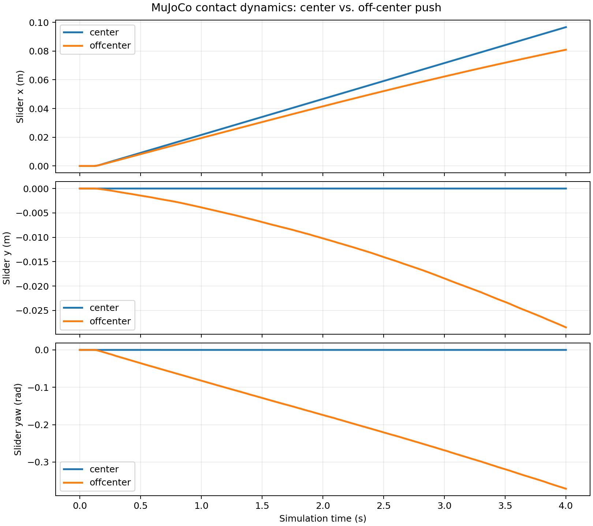

# MEAM 5170 — Planar Pushing

**Local vs. Sampling-Augmented MPC for Contact-Rich Planar Pushing under Model Uncertainty**

[English](README.md) | [简体中文](README.zh-CN.md)

A modular Python project for pushing a rectangular slider with a cylindrical pusher in MuJoCo. The simulator, prediction model, local controller, contact selection, and repositioning components have separate interfaces so they can be modified or replaced independently.

**Current version: 0.4.0. Steps 0–4 are implemented.** Sampling controller B and uncertainty-aware controller C are future work.

| Step | Implemented component |
|---|---|
| 0 | MuJoCo execution environment with independently configurable contact friction |
| 1 | Fixed-face, sticking quasi-static prediction model and numerical Jacobians |
| 2 | Explicit sparse OSQP-based local QP-MPC |
| 3 | Rule-based contact selection, stagnation detection, and task supervisor |
| 4 | Physical retreat, collision-free transit, and guarded contact approach |

The most recent full regression run passed **151 tests**. Headless simulation and actual Viewer runs have both been verified. Task-level success currently means position error within **5 mm**, yaw error within **3 degrees**, maintained for **0.2 s**; this is different from the steady-state error of a fixed-duration MPC experiment.

## Clone and install

```bash
mkdir -p ~/projects
cd ~/projects
git clone https://github.com/lloyd9179/meam5170-planar-pushing.git
cd meam5170-planar-pushing
python3.10 -m venv .venv
source .venv/bin/activate
unset PYTHONPATH  # unnecessary for this project; useful if the shell sourced ROS
python -m pip install -r requirements-lock.txt
python -m pip install --no-build-isolation --no-deps -e .
python -m pip check
```

Run subsequent commands from the repository root with the virtual environment active. The sections below preserve the development-stage instructions, APIs, results, and limitations from the Chinese README. Earlier stage descriptions refer to that stage's scope, not the scope of the current complete checkout.

```bash
# Full regression suite, without display variables
env -u DISPLAY -u WAYLAND_DISPLAY -u MUJOCO_GL python -m pytest -q

# Complete Controller A: reposition from the wrong side, then push
planar-pushing-rule --task reposition --with-reposition --duration 30 --headless

# The same task with a real desktop Viewer
planar-pushing-rule --task reposition --with-reposition --duration 30 --viewer
```

Source, configuration, the project-plan PDF, technical documents, and existing reference experiment records are included in the initial GitHub snapshot. `.venv`, caches, logs, and build products are excluded. Existing `results/` records are versioned so report links work; newly generated result directories remain ignored by Git. Do not commit a virtual environment when synchronizing work with teammates.

## Step 0 — MuJoCo simulation environment

The original Step 0 project title was **Sampling-Augmented MPC for Contact-Rich Planar Pushing under Model Uncertainty**.

This stage implements the MuJoCo execution environment. A rectangular slider is supported by gravity and table contact through a free joint, and a cylindrical pusher moves it through actual collisions. The core environment does not contain MPC, prediction logic, contact sampling, or ROS.

### Ubuntu 22.04 installation

Use system Python 3.10. There is no separate MuJoCo binary-library download, and this project does not use `mujoco-py`. See the [official Python package instructions](https://mujoco.readthedocs.io/en/stable/python.html).

```bash
# Install only if these system components are missing.
# Run sudo in your own terminal when needed.
sudo apt-get update
sudo apt-get install -y python3.10-venv git libgl1 libegl1 libglfw3

cd ~/projects/meam5170-planar-pushing
python3.10 -m venv .venv
source .venv/bin/activate
# A shell that sourced ROS may have /opt/ros entries in PYTHONPATH.
unset PYTHONPATH
python -m pip install -r requirements-lock.txt
python -m pip install --no-build-isolation --no-deps -e .
python -m pip check
python -c 'import mujoco; print(mujoco.__version__)'
```

`requirements-lock.txt` pins the dependencies actually used on Ubuntu x86_64 / Python 3.10, including build tools. On a different Python version or platform, `python -m pip install -e '.[dev]'` is an alternative, but bitwise-identical results are not guaranteed. The development machine already had venv and OpenGL/EGL libraries, and the GLFW Python wheel supplied its library, so no apt or sudo installation was needed during development.

### Run the experiments

```bash
cd ~/projects/meam5170-planar-pushing
source .venv/bin/activate
unset PYTHONPATH

# Independent demos: default speed 0.025 m/s, duration 4 s.
python -m planar_pushing.demo --mode center --headless --output-dir artifacts/center
python -m planar_pushing.demo --mode offcenter --headless --output-dir artifacts/offcenter

# Compare both; generate CSV, summary.json, and x/y/yaw plots.
python -m planar_pushing.demo --mode both --headless --output-dir artifacts/comparison

# Viewer: play in wall-clock time and close at the end of each experiment.
python -m planar_pushing.demo --mode center --viewer
python -m planar_pushing.demo --mode offcenter --viewer
planar-pushing-demo --mode both --viewer

# Change true-world contact friction.
python -m planar_pushing.demo --mode both --headless --mu-ground 0.2 --mu-pusher 0.7

# Automated acceptance without creating an OpenGL context.
env -u DISPLAY -u WAYLAND_DISPLAY -u MUJOCO_GL python -m pytest -q
python -m pytest tests/test_friction.py -v
```

Headless dynamics require no X11, GPU, OSMesa, or EGL context. Matplotlib uses Agg. If its default cache directory is not writable, use `export MPLCONFIGDIR="$PWD/artifacts/matplotlib"`. Viewer mode requires an accessible graphical session; `DISPLAY=:0` alone does not establish access. Both original Viewer demos were actually run outside the execution sandbox, with 200 synchronized frames each; X11 access from inside that sandbox was unavailable.

### Environment API

```python
from planar_pushing import EnvConfig, PlanarPushingEnv

env = PlanarPushingEnv(EnvConfig(mu_ground=0.3, mu_pusher=0.5))
state = env.reset(seed=0)
state, info = env.step([0.025, 0.0])  # world-frame m/s, held for 0.02 s
state = env.get_state()
print(state.slider_pose)             # (x, y, yaw), m/m/rad
print(state.pusher_position)         # (x, y), m
print(state.slider_linear_velocity)  # world (vx, vy, vz), m/s
print(state.slider_angular_velocity) # world (wx, wy, wz), rad/s
print(state.time)                    # s
print(info["applied_velocity"], info["speed_clipped"])
print(info["contacts"])             # actual geom names, friction, normal forces

env.set_friction(mu_ground=0.15)     # leaves mu_pusher unchanged
env.set_friction(mu_pusher=0.8)      # leaves mu_ground unchanged
print(env.get_friction())            # read compiled contact-pair parameters

# Defaults place the pusher outside the slider's local -X face.
state = env.reset(seed=0, slider_pose=(0.1, 0.0, 0.3))
# Explicit pusher positions must not overlap the initial slider.
state = env.reset(seed=0, pusher_position=(-0.073, 0.025))
```

`State` is an immutable dataclass. `slider_position` also includes z for checking support/lift; `theta` is yaw in [-pi, pi], so unwrap it for long trajectories. `step` returns `(State, info)`, not a Gym reward/done tuple. Input must be a finite length-2 vector. Its Euclidean norm is capped at 0.08 m/s while preserving direction. In the default mocap mode, each physics substep advances only the pusher's mocap pose; slider qpos/qvel are not written during stepping. Controllers should inspect `applied_velocity` to account for saturation. The optional physical velocity-servo mode introduced later is described below.

`reset(seed)` clears simulation time, velocities, contact state, and warm starts, while retaining runtime friction settings. There is currently no randomized initialization: all seeds give the same default initial state; the seed initializes an instance-local RNG without changing NumPy's global RNG. Recreate the configuration/environment to change dimensions, mass, or timestep. `EnvConfig` uses full dimensions, not MuJoCo half-dimensions. Each parallel worker should own its own environment instance.

### Physical model and independent friction

| Parameter | Default |
|---|---|
| Slider full dimensions / mass | 0.12 × 0.08 × 0.02 m / 0.2 kg |
| Initial slider pose | x=y=yaw=0; bottom starts 0.2 mm above the table |
| Pusher radius / height / center z | 0.01 / 0.016 / 0.01 m |
| Initial pusher position | (-0.073, 0); off-center demo uses y=0.025 m |
| Gravity | (0, 0, -9.81) m/s² |
| Physics / control timestep | 0.001 / 0.02 s, 20 substeps |
| Maximum pusher speed | 0.08 m/s |
| Solver / integrator | Newton, 100 iterations, tolerance 1e-10 / implicitfast |
| Contact | Elliptic cone, condim=3, margin=gap=0 |
| Contact softness | solref=(0.01, 1), solimp=(0.95, 0.99, 0.001, 0.5, 2) |
| Additional joint damping | 0; dissipation comes from contact friction |
| mu_ground / mu_pusher | 0.3 / 0.5; simulation defaults, not experimentally calibrated |
| Goal (x, y, yaw) | (0.12 m, 0.03 m, 0.4 rad); visual-only green outline |

The free body has no strict planar-joint constraint and permits small z/roll/pitch motion. The pusher is centered at the slider's center-of-mass height, with its bottom 2 mm above the table. The table is an infinite plane; red/green/blue thin axes indicate world X/Y/Z. The goal and other visualization geoms have no collisions.

For dynamically generated equal-priority contacts, MuJoCo mixes geom friction using an elementwise maximum. Changing only slider geom friction could therefore affect both interfaces. This model disables automatic collision masks and uses two **explicit contact pairs**:

- `ground_slider`: table ↔ slider_geom, friction=(mu_ground, mu_ground, 0.001, 0.0001, 0.0001).
- `pusher_slider`: pusher_geom ↔ slider_geom, friction=(mu_pusher, mu_pusher, 0.001, 0.0001, 0.0001).

Explicit pair parameters do not use geom mixing. The five components are two tangential, one torsional, and two rolling coefficients; condim=3 activates only tangential friction. Tests set all geom friction coefficients to 9 and still check full vectors in both `model.pair_friction` and actual loaded `data.contact[i].friction`, demonstrating independence. A zero coefficient can be configured, but MuJoCo applies an internal positive floor when constructing actual contacts.

References: [contact parameter mixing](https://mujoco.readthedocs.io/en/stable/modeling.html#contact-parameters), [explicit contact pairs](https://mujoco.readthedocs.io/en/stable/XMLreference.html#contact-pair).

### Step 0 tests and results

```text
25 passed
center:    translation=0.09662360 m, yaw=-0.00140362 deg
offcenter: translation=0.08577127 m, yaw=-21.28678875 deg
```

Tests cover initialization and table support, seeded reset reproducibility, pusher displacement/direction/time, speed saturation, invalid inputs, dimensions/mass/pose configuration, actual independent contact friction, centered/off-center pushing, and both complete CLI demos in a subprocess with display variables removed. Initialization is nonpenetrating; soft contact permits submillimeter overlap during simulation.

Physical acceptance thresholds: centered forward translation 40–120 mm, lateral drift <3 mm, |yaw|<0.03 rad; off-center translation >20 mm and clockwise yaw magnitude between 0.15 and 2.5 rad. Both must have at least 50 loaded-contact control steps, peak normal force >0.1 N, contact overlap <1 mm, vertical drift <1 mm, and tilt <0.05 rad. These bounds are tied to 100 mm commanded travel, a 120 mm slider length, and a 20 mm height; they allow solver variation while rejecting ineffective pushing, flight, and numerical-noise rotation. Reproducibility uses absolute tolerance 1e-12 on the same machine/dependency versions.



### Initial structure and integration

```text
README.md
README.zh-CN.md
pyproject.toml
requirements-lock.txt
models -> src/planar_pushing/models
src/planar_pushing/{__init__,env,demo}.py
src/planar_pushing/models/planar_pushing.xml
tests/{test_environment,test_pushing,test_friction}.py
docs/{step0_report.md,trajectories.png,validation.json}
artifacts/                         # generated CLI outputs, ignored by Git
```

MJCF is packaged with the Python distribution so a wheel can load it from any working directory; root `models` is a symlink to that same copy. MuJoCo is the execution/true world. Controllers share `reset → get_state → step([vx,vy])` while solving with an independent prediction model. `set_friction` retains runtime mu_true adjustment.

Limitations of the original mocap execution: ideal motion source without force/acceleration bounds, discrete position increments, and soft-contact error. Acceptance of the defaults does not imply stability for arbitrary dimensions, extreme friction, or fast impacts. The free body is approximately planar; yaw is not a full 3D orientation. Different MuJoCo/platform versions are not promised bitwise-identical trajectories. Friction has not been calibrated against hardware.

## Step 1 & Step 2 — Prediction model and local QP-MPC (v0.2.0)

The project title became **Local vs. Sampling-Augmented MPC for Contact-Rich Planar Pushing under Model Uncertainty**. The original Step 0 scene, default mocap mode, demos, and tests remain available.

These stages add a fixed-face sticking quasi-static model and an explicitly assembled sparse OSQP-MPC. Installation is unchanged; the lockfile adds SciPy 1.15.3, OSQP 1.1.3, and their dependencies.

```bash
source .venv/bin/activate
unset PYTHONPATH
python -m pip install -r requirements-lock.txt
python -m pip install --no-build-isolation --no-deps -e .
python -m pip check

env -u DISPLAY -u WAYLAND_DISPLAY -u MUJOCO_GL python -m pytest -q
python -m planar_pushing.validate_model --output-dir results
python -m planar_pushing.mpc_demo --backend model --task both --headless --output-dir results
python -m planar_pushing.mpc_demo --backend mujoco --task translation --headless --output-dir results
python -m planar_pushing.mpc_demo --backend mujoco --task rotation --headless --output-dir results
# Run four cases and compare them in shared plots.
planar-pushing-mpc --backend both --task both --headless --output-dir results
# Viewer requires an accessible desktop session.
planar-pushing-mpc --backend mujoco --task both --viewer --output-dir results
```

Each run creates a timestamped/unique directory with configuration, summary, NPZ state/control/prediction sequences, per-step solver/contact CSV, and PNG plots. Runs do not overwrite one another. `results/` ignores new output directories. Step 1 separates measured-state one-step error from identical-world-input open-loop error; slip and contact-loss samples are retained.

```python
from planar_pushing.models import ContactFace, ModelConfig, QuasiStaticPushingModel
from planar_pushing.control import LocalQPMPC, MPCConfig

model = QuasiStaticPushingModel(ModelConfig(ell=0.04163332, mu_pusher=0.5))
x = [0., 0., 0., 0.02]  # world px/py/yaw; body-face contact s
u = [0.01, 0.]           # local inward-normal / tangent point velocity
face = ContactFace.LEFT
xdot = model.continuous_dynamics(x, u, face)
xnext = model.discrete_dynamics(x, u, 0.02, face)
A, B = model.linearize(x, u, 0.02, face)
print(model.is_sticking_feasible(x, u, face))

mpc = LocalQPMPC(model, MPCConfig(horizon=15, dt=0.02))
result = mpc.solve(x, [0.03, -0.008, -0.1], face)
if result.feasible:
    print(result.control, result.predicted_states)
else:
    print(result.status, result.fallback_used)  # explicit zero-control fallback
mpc.reset()
```

Local MPC neither calls MuJoCo nor switches faces/repositions. The model uses $v_b=HA^T\operatorname{solve}(AHA^T,F)u$ and $\dot{s}=0$. Coulomb constraints apply to scaled contact force, not an unmotivated velocity ratio. Ground friction is not artificially multiplied into predicted velocity.

**Necessary execution adaptation:** advancing a mocap body's position does not provide its true surface velocity to contact dynamics, which distorts tangential MPC actuation. Step 1/2 use optional `EnvConfig(pusher_mode='velocity_servo')`: physical XY slide-joint velocity actuators, 0.0002 s physics substeps, gain 500 N/(m/s). Step 0 keeps its default mocap mode and original 25 tests. In servo mode, `info['applied_velocity']` is the saturated reference, while actual velocity can differ under load; this is not a perfect kinematic actuator.

Finite pusher radius, soft contact, and heuristic nominal ell still cause mismatch. Rotation cases can show real slip and s drift; nominal QP sticking feasibility does not prove physical sticking. Original mocap and coarse-servo-step failure logs are preserved and discussed. These experiments do not establish complete contact-mode prediction, global reachability, or hard real-time performance.

Technical records: [model derivation and parameters](docs/model_design.md), [QP construction and replacement guide](docs/mpc_design.md), [results and failure analysis](docs/step1_step2_report.md).

## Step 3 — Rule controller and component contracts (v0.3.0)

This stage adds baseline controller A, independent stagnation detection, contact monitoring, and a shared task supervisor. Original Step 0–2 APIs/code/tests remain; there are no additional dependencies. The rule returns `ContactTarget(face,s)`, and the supervisor confirms physical contact before invoking the existing local MPC. At this development stage, Step 4 was only a handoff interface; the current implementation is described in the next section.

```bash
python -m pip install --no-build-isolation --no-deps -e .
env -u DISPLAY -u WAYLAND_DISPLAY -u MUJOCO_GL python -m pytest -q

# Automatic rule-based contact selection and actual MuJoCo closed loop.
planar-pushing-rule --task translation --headless
planar-pushing-rule --task rotation --headless
planar-pushing-rule --task right --headless
planar-pushing-rule --task rotated --headless

# Without a motion port, these stop safely with a reposition request.
planar-pushing-rule --task reposition --headless
planar-pushing-rule --task stagnant --headless

# Run all six cases with comparison plots.
planar-pushing-rule --task all --headless
planar-pushing-rule --task rotation --viewer

# Custom world-frame goal and independent configuration (angles in rad).
planar-pushing-rule --task translation --config configs/step3_example.json --goal 0.05 0.0 0.0
```

JSON supports partial overrides for `env / model / mpc / geometry / rule / monitor / supervisor / progress` and `goal_pose`. `--goal` overrides JSON; select a single task when supplying a custom goal. Unknown sections/fields are errors. Partial env overrides use the Step 3 velocity-servo profile, while model parameters remain independent. Changing nominal friction does not change true friction. MPC dt must match env.dt_control; physical geometry must match the scene, while nominal model dimensions can be independently configured to study mismatch. Geometry corner_margin is independently adjustable.

```python
from planar_pushing import PlanarPushingEnv, EnvConfig
from planar_pushing.models import QuasiStaticPushingModel, ModelConfig
from planar_pushing.control import LocalQPMPC, MPCConfig
from planar_pushing.task import (
    RectangleGeometry, RuleContactSelector, ContactMonitor, TaskSupervisor
)
from planar_pushing.task.adapters import MuJoCoObservationAdapter, LocalMPCPushAdapter

# Construct execution and prediction separately; do not overwrite either's parameters.
env = PlanarPushingEnv(EnvConfig(pusher_mode='velocity_servo', dt_physics=.0002))
geometry = RectangleGeometry(*env.config.slider_size[:2], env.config.pusher_radius)
model = QuasiStaticPushingModel(ModelConfig())
controller = TaskSupervisor(
    RuleContactSelector(geometry),
    LocalMPCPushAdapter(LocalQPMPC(model, MPCConfig(dt=env.config.dt_control))),
    ContactMonitor(geometry),
)
observation = MuJoCoObservationAdapter(env).observe()
decision = controller.tick(observation, (0.04, 0.0, 0.0))
# This can be reposition_required: no Step 4 executor was injected here.
# Call tick once per simulation step and execute only its explicit world velocity.
env.step(decision.velocity_world)
```

Success defaults to 5 mm / 3 degrees held for 0.2 s. Therefore, final task-demo error is not directly comparable with Step 2's six-second steady-state error. `stagnant` uses the same fixed rotation task with a stricter tolerance, retaining the local residual so real stagnation/reselection occurs; it does not freeze or move the slider to manufacture the event.

See [interfaces and modification boundaries](docs/component_contracts.md), [Step 3 algorithm and parameters](docs/step3_design.md), and [Step 3 validation](docs/step3_report.md). Replace the selector to change contact policy, adapt the push controller to replace MPC/models, and use the motion ports for Step 4; the task supervisor stays shared.

## Step 4 — Physical repositioning (v0.4.0)

**RETRACT → collision-free TRANSIT → guarded APPROACH** is implemented through the existing `RepositionExecutor` port. It does not reset the scene, write slider state, or teleport. Original Step 0–2 remain unchanged; Step 3's port-free behavior remains available for regression and comparison.

```bash
python -m pip install --no-build-isolation --no-deps -e .
python -m pytest -q

# Opposite/adjacent/same-face targets, rotated slider, and free-position start.
planar-pushing-motion --case all --headless
planar-pushing-motion --case opposite --viewer

# Controller A starts on the wrong side, repositions, confirms contact, and pushes.
planar-pushing-rule --task reposition --with-reposition --duration 30 --headless

# Switching faces during one continuous episode.
planar-pushing-rule --task translation --goal 0.04 0.04 0 --with-reposition --duration 30 --headless

# Editable planning/execution/cost settings; true and nominal parameters stay separate.
planar-pushing-rule --task reposition --with-reposition --duration 30 --config configs/step4_example.json --headless
```

Without `--with-reposition`, the original Step 3 commands still return a request and stop when movement is needed. In logs, `step4_enabled` indicates whether a physical motion port was used; historical `step4_implemented` is a compatibility alias with that same meaning, not an indicator of whether the package contains the module.

The default planner uses conservative rectangle inflation and a visibility graph, filters collision paths first, and selects among valid routes with an interchangeable cost evaluator. `Jtravel` remains retreat-plus-transit length to precontact, in meters. The default route cost is nominal retreat/transit/approach time plus turn penalty and fixed settling time, in seconds; it is separate from the MPC pushing cost. The executor reads actual position/velocity and checks pose drift, swept segments, load, contact geometry, timeout, and replan count. After motion READY, the supervisor independently confirms contact before activating MPC.

```python
from planar_pushing.motion import (
    VisibilityRepositionPlanner, FeedbackRepositionExecutor,
    NominalTimeCost, PlannerConfig, MotionConfig, TravelCostConfig,
)

# geometry, monitor, and env are constructed as in the previous API example.
cost = NominalTimeCost(geometry, TravelCostConfig())
planner = VisibilityRepositionPlanner(geometry, PlannerConfig(), cost_evaluator=cost)
executor = FeedbackRepositionExecutor(geometry, planner, monitor,
                                      MotionConfig(dt=env.config.dt_control))
# Inject executor into TaskSupervisor; selector/model/MPC need no changes.
```

Replace `RepositionPlanner` for another routing algorithm, `RepositionCostEvaluator` for another objective, and `RepositionExecutor` for another tracking strategy. `CollisionChecker` is independently injectable. These components do not depend on the quasi-static state dimension, Jacobians, QP solver, or nominal friction. See [Step 4 design and cost derivation](docs/step4_design.md), [current contracts](docs/component_contracts.md), and [Step 4 results](docs/step4_report.md).

## Synchronizing with teammates

```bash
git pull --ff-only
git switch -c your-change
# Edit, run relevant tests, then commit source/config/documentation changes.
git add <changed-files>
git commit -m "Describe the change"
git push -u origin your-change
```

Open a pull request for review. Direct push access requires a collaborator invitation from the repository owner; public visibility alone does not grant write access. When adding results, include only the intended reference run explicitly; newly generated result directories remain ignored.
