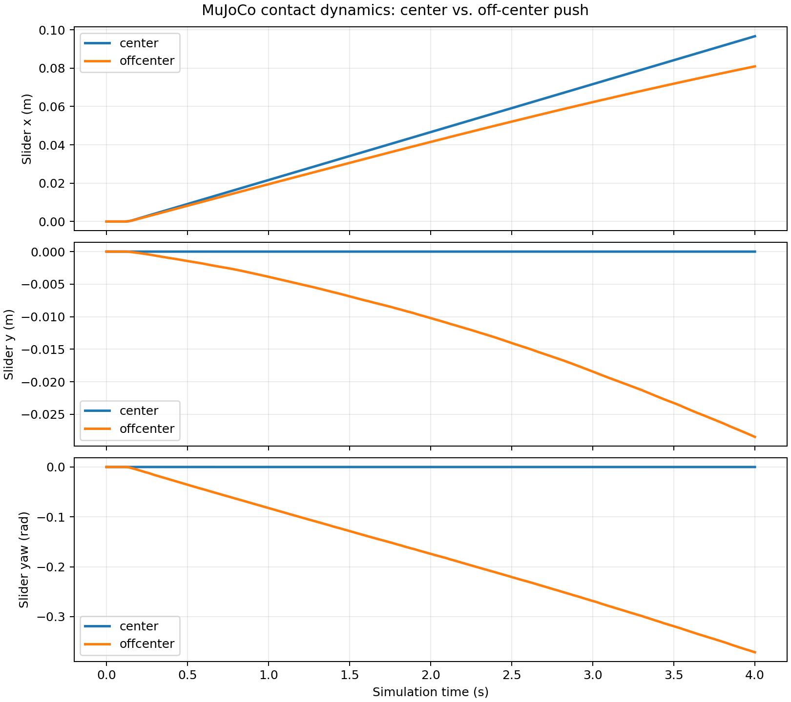

# MEAM 5170 — Planar Pushing

**Local vs. Sampling-Augmented MPC for Contact-Rich Planar Pushing under Model Uncertainty**

[English](README.md) | [简体中文](README.zh-CN.md)

当前版本 **0.4.0**，Step 0–4 已完成；Sampling Controller B 和 Uncertainty-Aware Controller C 属于后续工作。仿真、预测模型、局部控制、选点与重定位分别具有独立接口。

| Step | 已完成内容 |
|---|---|
| 0 | MuJoCo 执行环境与独立接触摩擦配置 |
| 1 | 固定面 sticking 准静态预测模型与数值 Jacobian |
| 2 | 自行构建稀疏 QP 的 OSQP Local MPC |
| 3 | 规则选点、停滞检测与共享任务状态机 |
| 4 | 真实退离、无接触绕行与受控接近 |

最新完整回归为 **151 项测试通过**；Headless 与实际 Viewer 均已验证。任务成功阈值为5mm/3deg，连续保持0.2s，与固定时长MPC实验的稳态误差是不同指标。

## 克隆与快速安装

```bash
mkdir -p ~/projects
cd ~/projects
git clone https://github.com/lloyd9179/meam5170-planar-pushing.git
cd meam5170-planar-pushing
python3.10 -m venv .venv
source .venv/bin/activate
unset PYTHONPATH
python -m pip install -r requirements-lock.txt
python -m pip install --no-build-isolation --no-deps -e .
python -m pip check

env -u DISPLAY -u WAYLAND_DISPLAY -u MUJOCO_GL python -m pytest -q
planar-pushing-rule --task reposition --with-reposition --duration 30 --headless
planar-pushing-rule --task reposition --with-reposition --duration 30 --viewer
```

以下保留原来的分阶段说明；早期章节中的范围描述对应当时阶段，当前完整功能以Step 4为准。后续命令默认在repo根目录、已激活venv的环境运行；路径可替换为自己的克隆位置。

本次GitHub初始快照包含源码、配置、项目计划PDF、技术文档与已有参考实验记录。虚拟环境、缓存、日志、构建产物不上传。已有results被显式纳入版本以保持报告链接可读；以后新生成的运行目录仍由.gitignore忽略。

---

# MEAM 5170 — Step 0: Planar Pushing

**Sampling-Augmented MPC for Contact-Rich Planar Pushing under Model Uncertainty**

本仓库仅实现 MuJoCo 执行环境。矩形 Slider 通过自由关节和重力由桌面支撑，圆柱 Pusher 通过真实碰撞推动它。核心环境不包含 MPC、预测模型、接触采样或 ROS。

## Ubuntu 22.04 安装

使用系统 Python 3.10；无需单独下载 MuJoCo 二进制库，也不使用 `mujoco-py`。
官方说明：[Python package](https://mujoco.readthedocs.io/en/stable/python.html)。

```bash
# 仅在缺少以下系统组件时安装；sudo 由用户在终端执行。
sudo apt-get update
sudo apt-get install -y python3.10-venv git libgl1 libegl1 libglfw3

cd ~/projects/meam5170-planar-pushing
python3.10 -m venv .venv
source .venv/bin/activate
# 已 source ROS 的 shell 可能带有 /opt/ros 的 PYTHONPATH；本项目不需要它。
unset PYTHONPATH
python -m pip install -r requirements-lock.txt
python -m pip install --no-build-isolation --no-deps -e .
python -m pip check
python -c 'import mujoco; print(mujoco.__version__)'
```

`requirements-lock.txt` 锁定了本次 Ubuntu x86_64 / Python 3.10 实测依赖，包括构建工具。跨 Python 版本或平台可改用 `python -m pip install -e '.[dev]'`，但结果不保证与当前版本逐位一致。本次机器已有 venv 与 OpenGL/EGL 库，GLFW Python wheel 自带所需库，因此没有执行 apt 或 sudo。

## 运行实验

```bash
cd ~/projects/meam5170-planar-pushing
source .venv/bin/activate
unset PYTHONPATH

# 两个实验可以单独运行；默认速度 0.025 m/s，持续 4 s。
python -m planar_pushing.demo --mode center --headless --output-dir artifacts/center
python -m planar_pushing.demo --mode offcenter --headless --output-dir artifacts/offcenter

# 同时比较，生成 CSV、summary.json 以及包含 x/y/yaw 的图。
python -m planar_pushing.demo --mode both --headless --output-dir artifacts/comparison

# Viewer：真实桌面终端中运行，按墙钟时间播放，实验结束自动关闭。
python -m planar_pushing.demo --mode center --viewer
python -m planar_pushing.demo --mode offcenter --viewer
# 也可依次播放两个实验
planar-pushing-demo --mode both --viewer

# 修改真实世界摩擦参数
python -m planar_pushing.demo --mode both --headless --mu-ground 0.2 --mu-pusher 0.7

# 自动化验收：显式去除所有显示环境变量，不创建 OpenGL context
env -u DISPLAY -u WAYLAND_DISPLAY -u MUJOCO_GL python -m pytest -q
python -m pytest tests/test_friction.py -v
```

Headless 动力学不需要 X11、GPU、OSMesa 或 EGL context，Matplotlib 使用 Agg。若受限环境中 Matplotlib 缓存目录不可写，可设置 `export MPLCONFIGDIR="$PWD/artifacts/matplotlib"`。Viewer 需要有效的 X11/图形会话；`DISPLAY=:0` 本身不代表可访问。在 Codex 沙箱外实际启动并完成了两个 Viewer 实验，各 200 帧；沙箱内无法连接 X11。

## 环境 API

```python
from planar_pushing import EnvConfig, PlanarPushingEnv

env = PlanarPushingEnv(EnvConfig(mu_ground=0.3, mu_pusher=0.5))
state = env.reset(seed=0)
state, info = env.step([0.025, 0.0])  # 世界坐标速度 m/s，执行 0.02 s
state = env.get_state()
print(state.slider_pose)             # (x, y, yaw)，m、m、rad
print(state.pusher_position)         # (x, y)，m
print(state.slider_linear_velocity)  # 世界坐标 (vx, vy, vz)，m/s
print(state.slider_angular_velocity) # 世界坐标 (wx, wy, wz)，rad/s
print(state.time)                    # s
print(info["applied_velocity"], info["speed_clipped"])
print(info["contacts"])             # 实际接触的 geom 名称、摩擦、法向力等

env.set_friction(mu_ground=0.15)     # 不改变 mu_pusher
env.set_friction(mu_pusher=0.8)      # 不改变 mu_ground
print(env.get_friction())            # 读取已编译模型中的 pair 参数

# reset 可配置初始位姿；默认 Pusher 自动放到 Slider 局部 -X 面外。
state = env.reset(seed=0, slider_pose=(0.1, 0.0, 0.3))
# 显式位置必须避免与 Slider 初始重叠
state = env.reset(seed=0, pusher_position=(-0.073, 0.025))
```

`State` 是不可变 dataclass，`slider_position` 还包含 z 供检查离桌情况；`theta` 为 [-π, π] 的 yaw，长轨迹需展开角度。`step` 返回 `(State, info)`，不是 Gym 的 reward/done 接口。`u` 必须是长度为 2 的有限向量；按欧氏范数限制到 0.08 m/s，保留方向。速度在每个控制周期恒定，每个物理子步仅移动 Pusher 的 mocap 位姿，不写 Slider 的 qpos/qvel。控制器应读取 `applied_velocity` 处理饱和。

`reset(seed)` 清空时间、速度、接触和 warm start，保留运行时设置的摩擦。当前没有随机初始化，所有 seed 产生相同默认初始条件；seed 只初始化实例内 RNG，不改变全局 NumPy 随机状态。修改尺寸、质量或时间步需重新创建 `EnvConfig`/环境。`EnvConfig` 的参数是完整尺寸，不是 MuJoCo 的半尺寸。每个并行仿真 worker 使用独立环境实例。

## 模型与两组摩擦

| 参数 | 默认值 |
|---|---|
| Slider 完整尺寸 / 质量 | 0.12 × 0.08 × 0.02 m / 0.2 kg |
| Slider 初始姿态 | x=y=yaw=0，底面离桌 0.2 mm |
| Pusher 半径 / 高度 / 中心 z | 0.01 / 0.016 / 0.01 m |
| Pusher 初始位置 | (-0.073, 0)，偏心实验 y=0.025 m |
| 重力 | (0, 0, -9.81) m/s² |
| physics / control timestep | 0.001 / 0.02 s，20 个子步 |
| 最大 Pusher 速度 | 0.08 m/s |
| Solver / integrator | Newton，100 iterations，tolerance 1e-10 / implicitfast |
| Contact | elliptic cone，condim=3，margin=gap=0 |
| Contact softness | solref=(0.01, 1)，solimp=(0.95, 0.99, 0.001, 0.5, 2) |
| 额外关节阻尼 | 0；运动耗散来自接触摩擦 |
| mu_ground / mu_pusher | 0.3 / 0.5，仿真初值，未经实验标定 |
| Goal (x, y, yaw) | (0.12 m, 0.03 m, 0.4 rad)，绿色边框，仅可视化 |

自由刚体未施加平面关节约束，允许小幅 z/roll/pitch 运动。Pusher 对中于 Slider 质心高度，下缘离桌 2 mm；避免无意义的 Pusher–桌面摩擦。桌面是无限平面，RGB 细轴分别表示世界 X/Y/Z。绿色边框及其他可视化几何体均无碰撞。

MuJoCo 动态接触在 geom 优先级相同时对摩擦逐元素取最大值，因此单纯修改 Slider geom 会同时影响两个界面。本模型禁用所有自动碰撞 mask，仅启用两个**显式 contact pair**：

- `ground_slider`: table ↔ slider_geom，friction=(mu_ground, mu_ground, 0.001, 0.0001, 0.0001)。
- `pusher_slider`: pusher_geom ↔ slider_geom，friction=(mu_pusher, mu_pusher, 0.001, 0.0001, 0.0001)。

显式 pair 直接指定参数，不使用 geom 混合值。五个分量依次是两个切向、一个扭转、两个滚动系数；condim=3 只激活切向摩擦。测试将所有 geom 摩擦改成 9，仍检查 `model.pair_friction` 和 `data.contact[i].friction` 的完整向量及非零载荷，证明两个界面可独立配置。零系数可设置，但 MuJoCo 生成接触时会应用内部正数下限。

参考：[Contact parameter mixing](https://mujoco.readthedocs.io/en/stable/modeling.html#contact-parameters)、[Explicit contact pairs](https://mujoco.readthedocs.io/en/stable/XMLreference.html#contact-pair)。

## 测试和结果

```text
25 passed
center:    translation=0.09662360 m, yaw=-0.00140362 deg
offcenter: translation=0.08577127 m, yaw=-21.28678875 deg
```

测试覆盖初始化/落桌支撑、相同 seed 轨迹复现、Pusher 方向/位移/时间、速度饱和、非法输入、尺寸质量初始姿态配置、真实接触摩擦、中心与偏心推动，以及完全移除显示变量的独立 CLI 子进程。初始化无穿透；仿真中接触是软约束，允许亚毫米重叠。

物理验收界限：中心 x 平移 40–120 mm，横向漂移 <3 mm，|yaw|<0.03 rad；偏心平移 >20 mm，顺时针 yaw 幅度 >0.15 rad 且 <2.5 rad；两者至少 50 个控制步有接触，峰值法向力 >0.1 N，接触重叠 <1 mm，竖向漂移 <1 mm，倾斜 <0.05 rad。界限针对 100 mm 的命令行程、120 mm 的物块长度和 20 mm 的高度设定，保留求解器余量，同时排除无效推动、弹飞和仅有数值噪声的旋转。复现容差为绝对误差 1e-12（同一机器和依赖版本）。



## 目录和后续集成

```text
README.md
pyproject.toml                  # package 和 CLI 定义
requirements-lock.txt           # 全部依赖的实测锁定版本
models -> src/planar_pushing/models
src/planar_pushing/{__init__,env,demo}.py
src/planar_pushing/models/planar_pushing.xml
tests/{test_environment,test_pushing,test_friction}.py
docs/{step0_report.md,trajectories.png,validation.json}
artifacts/                      # CLI 输出，Git 忽略
```

XML 放入 package data，安装 wheel 后从任何工作目录都可加载；根目录 `models` 是同一份文件的符号链接。MuJoCo 作为 execution/true world，未来控制器可以共享 `reset → get_state → step([vx,vy])` 接口，在独立预测模型里求解。`set_friction` 保留运行时调整 mu_true 的能力。此处不定义 mu_model、Jacobian 或优化器。

限制：mocap 为理想运动源、无力/加速度上限；速度靠逐子步位置增量实现，因此接触具有有限离散误差。默认参数通过验收，并不代表任意尺寸、极端摩擦或高速碰撞都稳定。自由体不是严格二维模型，yaw 也不是完整 3D 姿态；需要完整模型状态的控制器应另行扩展接口。不同 MuJoCo/平台版本不承诺逐位复现。没有真实硬件摩擦标定，也未实现任何后续控制算法。

# Step 1 & Step 2 (v0.2.0)

项目标题更新为 **Local vs. Sampling-Augmented MPC for Contact-Rich Planar Pushing under Model Uncertainty**。原 Step 0 场景、默认 mocap 模式、Demo 和测试继续保留。

新增固定面 sticking 准静态模型与显式构建的稀疏 OSQP-MPC。安装命令不变；依赖锁新增 SciPy 1.15.3、OSQP 1.1.3 及其依赖。

```bash
cd ~/projects/meam5170-planar-pushing
source .venv/bin/activate
unset PYTHONPATH
python -m pip install -r requirements-lock.txt
python -m pip install --no-build-isolation --no-deps -e .
python -m pip check

env -u DISPLAY -u WAYLAND_DISPLAY -u MUJOCO_GL python -m pytest -q
python -m planar_pushing.validate_model --output-dir results
python -m planar_pushing.mpc_demo --backend model --task both --headless --output-dir results
python -m planar_pushing.mpc_demo --backend mujoco --task translation --headless --output-dir results
python -m planar_pushing.mpc_demo --backend mujoco --task rotation --headless --output-dir results
# 一次运行四组闭环并在同一张图上对比
planar-pushing-mpc --backend both --task both --headless --output-dir results
# Viewer（需要可访问的桌面显示；不是 headless 测试的依赖）
planar-pushing-mpc --backend mujoco --task both --viewer --output-dir results
```

每次运行创建带时间戳/随机后缀的目录，保存配置、summary、NPZ 状态/控制/预测序列、逐步 solver/contact CSV 和 PNG，不覆盖上一次结果。`results/` 被 Git 忽略。Step 1 区分 measured-state one-step error 与 identical-world-input open-loop error，所有滑移和失去接触的样本均保留。

```python
from planar_pushing.models import ContactFace, ModelConfig, QuasiStaticPushingModel
from planar_pushing.control import LocalQPMPC, MPCConfig

model = QuasiStaticPushingModel(ModelConfig(ell=0.04163332, mu_pusher=0.5))
x = [0., 0., 0., 0.02]  # world px, py, yaw; body-face contact s
u = [0.01, 0.]           # local inward-normal / tangent point velocity
face = ContactFace.LEFT
xdot = model.continuous_dynamics(x, u, face)
xnext = model.discrete_dynamics(x, u, 0.02, face)
A, B = model.linearize(x, u, 0.02, face)
print(model.is_sticking_feasible(x, u, face))

mpc = LocalQPMPC(model, MPCConfig(horizon=15, dt=0.02))
result = mpc.solve(x, [0.03, -0.008, -0.1], face)
if result.feasible:
    print(result.control, result.predicted_states)
else:
    print(result.status, result.fallback_used)  # explicit zero-control fallback
mpc.reset()
```

Local MPC 不调用 MuJoCo，也不进行换面或重定位。数学采用 \(v_b=HA^T\operatorname{solve}(AHA^T,F)u\)，\(\dot s=0\)，Coulomb cone 施加在缩放接触力而非未经推导的速度比上。地面摩擦比例不会被人为乘入模型速度。

**必要的执行方式适配：**原 mocap 模式的位置更新不提供真实表面速度，偏心 MPC 的切向控制因此失真。Step 1/2 使用可选 `EnvConfig(pusher_mode='velocity_servo')`，通过两个 XY slide joint 的真实速度 actuator 推动，物理子步 0.0002 s、gain=500 N/(m/s)。Step 0 默认仍为 mocap，25 个原测试不变。`info['applied_velocity']` 在伺服模式是限幅后的参考速度，实际速度会受接触负载影响；它不是运动学完美执行器。

有限半径、soft contact 和 nominal ell 仍带来模型误差。旋转结果可能包含实际滑移和 s 漂移；QP 的 sticking 可行性不能证明真实 sticking。原 mocap 与粗步长 servo 的失败日志保留，并在报告中说明。不要以这些实验声称完整接触模式预测、全局可达性或硬实时保证。

详细技术记录：[模型推导与参数表](docs/model_design.md)、[QP 构造与替换指南](docs/mpc_design.md)、[实测报告与失败分析](docs/step1_step2_report.md)。

# Step 3 (v0.3.0): rule controller and stable component contracts

新增规则 Controller A、独立停滞检测、接触监测与 shared task supervisor。原 Step 0–2 代码/API/测试保留，没有新增 Python 依赖。规则返回 `ContactTarget(face,s)`；状态机确认物理接触后调用原 Local QP-MPC。Step 4 本轮只有明确的接口和 handoff，**尚未实现绕行**。

```bash
cd ~/projects/meam5170-planar-pushing
source .venv/bin/activate
unset PYTHONPATH
python -m pip install --no-build-isolation --no-deps -e .
env -u DISPLAY -u WAYLAND_DISPLAY -u MUJOCO_GL python -m pytest -q

# 规则自动选点，MuJoCo 真实闭环
planar-pushing-rule --task translation --headless
planar-pushing-rule --task rotation --headless
planar-pushing-rule --task right --headless
planar-pushing-rule --task rotated --headless

# 明确检查 Step 4 边界与停滞重新选点；会安全停止而非完成换面
planar-pushing-rule --task reposition --headless
planar-pushing-rule --task stagnant --headless

# 一次运行六组并出比较图；每次新建 results/step3_<timestamp>_<id>
planar-pushing-rule --task all --headless
# 实际桌面 Viewer
planar-pushing-rule --task rotation --viewer

# 自定义目标和独立组件参数（角度单位 rad）
planar-pushing-rule --task translation --config configs/step3_example.json --goal 0.05 0.0 0.0
```

示例 JSON 可部分覆盖 `env / model / mpc / geometry / rule / monitor / supervisor / progress`，以及 `goal_pose`。`--goal` 优先于 JSON；自定义 goal 时只运行单个 task。未知 section/field 明确报错。env 部分覆盖以 Step 3 的 velocity_servo profile 为默认；model 参数完全独立。修改 nominal friction 不会顺带改变真实摩擦。MPC dt 必须与 env.dt_control 一致；物理 geometry 必须与场景尺寸一致，名义模型尺寸可独立配置以明确研究模型失配。geometry 的 corner_margin 可独立修改。

```python
from planar_pushing import PlanarPushingEnv, EnvConfig
from planar_pushing.models import QuasiStaticPushingModel, ModelConfig
from planar_pushing.control import LocalQPMPC, MPCConfig
from planar_pushing.task import (
    RectangleGeometry, RuleContactSelector, ContactMonitor, TaskSupervisor
)
from planar_pushing.task.adapters import MuJoCoObservationAdapter, LocalMPCPushAdapter

# 环境和模型分别构造，不互相覆盖参数。
env = PlanarPushingEnv(EnvConfig(pusher_mode='velocity_servo', dt_physics=.0002))
geometry = RectangleGeometry(*env.config.slider_size[:2], env.config.pusher_radius)
model = QuasiStaticPushingModel(ModelConfig())
controller = TaskSupervisor(
    RuleContactSelector(geometry),
    LocalMPCPushAdapter(LocalQPMPC(model, MPCConfig(dt=env.config.dt_control))),
    ContactMonitor(geometry),
)
observation = MuJoCoObservationAdapter(env).observe()
decision = controller.tick(observation, (0.04, 0.0, 0.0))
# decision 可能是 reposition_required：当前没有注入 Step 4 executor。
# runner 每个仿真步调用一次 tick，始终只执行明确返回的世界速度。
env.step(decision.velocity_world)
```

成功阈值默认5mm/3deg，并连续保持0.2s；因此本任务级 Demo 的最终误差不能和 Step 2 连续推动6s的稳态误差直接混比。`stagnant` 使用固定相同旋转目标和更严格阈值，保留当前模型的小残差，实际触发停滞/重新选点，没有冻结或移动 Slider 来制造事件。

技术记录：[接口与修改边界](docs/component_contracts.md)、[Step 3 算法与参数](docs/step3_design.md)、[实测报告](docs/step3_report.md)。以后替换选点策略只修改 selector，替换 MPC/模型通过 push adapter 接入；Step 4 在 RepositionPlanner/RepositionExecutor port 内实现，继续复用同一个 supervisor。

# Step 4 (v0.4.0): physical repositioning

已实现 **退离 RETRACT → 无接触绕行 TRANSIT → 受控接近 APPROACH**，通过既有 RepositionExecutor port 接入同一个 TaskSupervisor。不重置场景，不修改物块状态，不瞬移。原 Step 0–2 不变；Step 3 不启用 motion port 的独立行为继续保留，以便做回归和对照。

```bash
cd ~/projects/meam5170-planar-pushing
source .venv/bin/activate
unset PYTHONPATH
python -m pip install --no-build-isolation --no-deps -e .
python -m pytest -q

# 独立运动验证：对侧/相邻/同面换点/物块旋转/自由位置起步
planar-pushing-motion --case all --headless
planar-pushing-motion --case opposite --viewer

# Controller A 从错误一侧开始，真实绕行、确认接触后推动至目标
planar-pushing-rule --task reposition --with-reposition --duration 30 --headless

# 同一次连续仿真中的换面任务
planar-pushing-rule --task translation --goal 0.04 0.04 0 --with-reposition --duration 30 --headless

# 可编辑的规划/运动/代价配置；env 与 model 参数仍独立
planar-pushing-rule --task reposition --with-reposition --duration 30 --config configs/step4_example.json --headless
```

没有 `--with-reposition` 的原 Step 3 命令仍会在需移动时返回请求并停止。日志中 `step4_enabled` 是当前是否启用真实运动端口；历史字段 `step4_implemented` 保留为相同含义的兼容别名，不用于判断安装包是否包含模块。

默认路径规划是矩形保守膨胀 + 可见图，先过滤碰撞路径，再由可替换 cost evaluator 选择路线。`Jtravel=退离+绕行至预接触点的长度(m)` 保持原定义；默认选路 total cost 是预计退离/绕行/接近时间，加转弯代价和固定稳定时间，单位 s。它不是 MPC 的推动代价。执行器每步读实际位置/速度，检查位姿漂移、扫掠线段、载荷、接触几何、超时和重规划次数；运动端 READY 后 supervisor 仍独立确认接触再调用 MPC。

```python
from planar_pushing.motion import (
    VisibilityRepositionPlanner, FeedbackRepositionExecutor,
    NominalTimeCost, PlannerConfig, MotionConfig, TravelCostConfig,
)

cost = NominalTimeCost(geometry, TravelCostConfig())
planner = VisibilityRepositionPlanner(geometry, PlannerConfig(), cost_evaluator=cost)
executor = FeedbackRepositionExecutor(geometry, planner, monitor,
                                      MotionConfig(dt=env.config.dt_control))
# 将 executor 注入已有 TaskSupervisor 即可；selector / model / MPC 不需修改。
```

替换路径算法实现 RepositionPlanner；替换评分实现 RepositionCostEvaluator；替换运动控制实现 RepositionExecutor；碰撞检查可独立注入 CollisionChecker。上述组件不依赖准静态模型状态维度、Jacobian、QP solver 或预测摩擦参数。详见 [Step 4 设计与代价推导](docs/step4_design.md)、[当前接口约定](docs/component_contracts.md)、[实测报告](docs/step4_report.md)。


## 与队友同步

```bash
git pull --ff-only
git switch -c your-change
# 修改代码，运行相关测试后提交源码/配置/文档。
git add <changed-files>
git commit -m "Describe the change"
git push -u origin your-change
```

通过Pull Request进行review。Public仓库允许读取和克隆，不自动授予写权限；队友直接push需要仓库owner另行邀请。新增实验输出应只显式提交需要保存的参考运行，其他新结果目录继续忽略。
