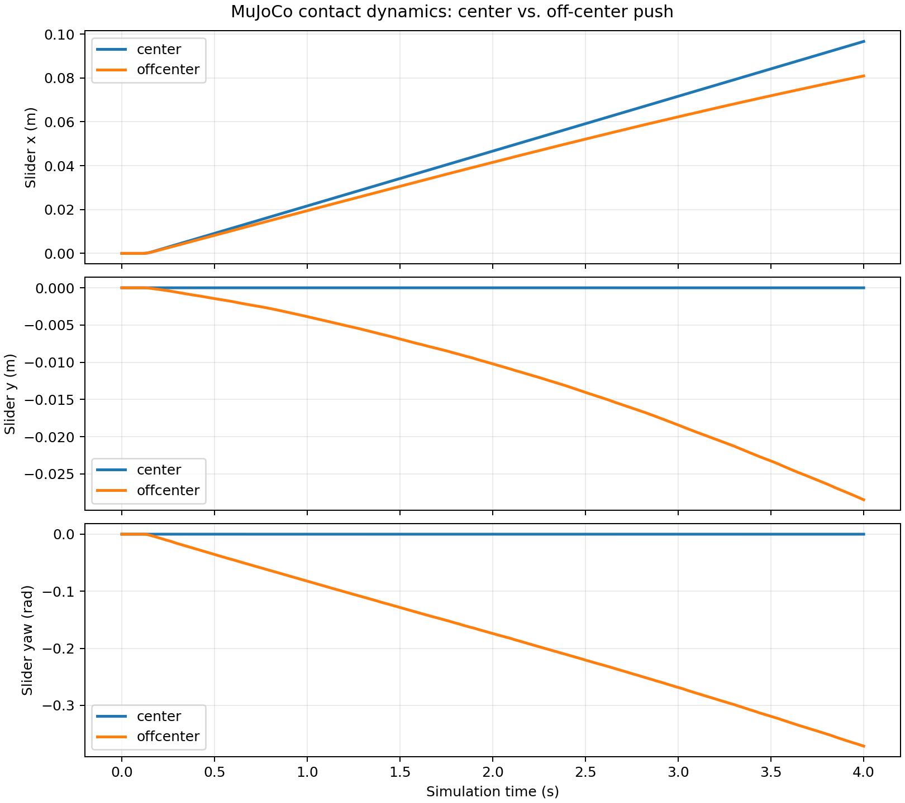

# Step 0 实施与验证报告

日期：2026-11-06（America/New_York）

项目：Sampling-Augmented MPC for Contact-Rich Planar Pushing under Model Uncertainty。

## 实施范围与交付位置

项目创建于 `/home/jyguan/projects/meam5170-planar-pushing`。检查时目标目录不存在；创建后仅添加本项目文件与 `.venv`，没有覆盖用户已有项目。仅初始化本地 Git，未创建 remote、提交或 GitHub 仓库。

已完成 MJCF、核心 API、两个独立 CLI demo、依赖锁、README、自动测试与 x/y/yaw 比较图。没有实现 ROS、机械臂、MPC/QP、准静态预测器或接触选择。

```text
.gitignore
README.md
pyproject.toml
requirements-lock.txt
models -> src/planar_pushing/models
src/planar_pushing/__init__.py
src/planar_pushing/env.py
src/planar_pushing/demo.py
src/planar_pushing/models/planar_pushing.xml
tests/test_environment.py
tests/test_pushing.py
tests/test_friction.py
docs/step0_report.md
docs/trajectories.png
docs/validation.json
```

`.venv`、缓存、`artifacts/`、构建产物和日志被 Git 忽略。MJCF 随 wheel 打包，根目录 models 是其符号链接，避免维护两份配置。

## 系统与安装

| 项目 | 实测版本 / 说明 |
|---|---|
| OS / 架构 | Ubuntu 22.04.5 LTS / x86_64 |
| Python | 系统 Python 3.10.12，用于创建独立 venv |
| Git | 2.34.1 |
| MuJoCo | 官方 Python package 3.17.0 |
| NumPy | 2.2.6 |
| Matplotlib | 3.10.9，headless 使用 Agg |
| pytest / build | 9.2.0 / 1.6.1 |
| pip / setuptools / wheel | 26.3 / 84.2.1 / 0.48.0 |
| GLFW / PyOpenGL | 2.11.0 / 3.1.10 |
| 系统图形库 | libgl1、libegl1 已存在；NVIDIA 和 Mesa GLX/EGL 可用 |
| 显示服务 | X.Org 1.21.1.4，DISPLAY=:0 |

系统 Python 最初没有 pip，也没有 MuJoCo；`python3.10 -m venv` 成功提供 venv pip。所有 Python 包只安装在项目 `.venv`。没有安装系统级软件，也没有使用 sudo。已有 `python3.10-venv` 和图形库足够，GLFW wheel 自带库。README 提供缺少这些组件时的准确 apt 命令。

当前 shell 的 PYTHONPATH 包含 `/opt/ros/humble/...`，因此记录依赖和最终安装验收时显式移除此变量；锁文件不包含 ROS 软件包。本项目不导入 ROS。

## 物理参数与执行接口

Slider 是 0.12 × 0.08 × 0.02 m、0.2 kg 的 box，使用一个 free joint。重力为 -9.81 m/s²，桌面是 z=0 的固定平面。初始底面高于桌面 0.2 mm；之后自然落桌。没有 planar joint、隐藏轨迹约束或手动添加的滑块速度。

Pusher 是半径 10 mm、高 16 mm 的竖直圆柱，中心 z=10 mm，下缘离桌 2 mm。使用 mocap body。速度输入为世界坐标 `[vx, vy]`，每 20 ms 控制周期内恒定，使用 20 个 1 ms 子步，在每个子步将 mocap 水平位置增加 `u*dt_physics` 后调用 `mj_step`。默认 demo 速度 0.025 m/s，对应 25 μm/子步；最大速度范数 0.08 m/s，对应 80 μm/子步。`step` 只移动 Pusher；Slider qpos 只在 reset 中设置。

求解配置：implicitfast、Newton、100 次迭代上限、tolerance=1e-10、elliptic friction cone；所有接触 condim=3，solref=(0.01, 1)，solimp=(0.95, 0.99, 0.001, 0.5, 2)，margin=gap=0；没有额外关节阻尼。关闭数值不稳定时自动重置，API 检查非有限状态与 MuJoCo warning，出现异常即抛出错误。

`reset(seed=0)` 返回不可变 State，清空时间、速度、warm start 与 mocap 状态，保留运行时摩擦。当前初始化无随机化，seed 控制预留的局部 RNG；不会声称不同 seed 产生不同状态。`step(u)` 返回 `(State, info)`，`get_state()` 返回世界坐标位置/线速度/角速度和 yaw/time，不要求上层读取 qpos 索引。配置支持完整尺寸、质量、初始 Slider/Pusher、Goal、时间步和速度上限。输入维度、有限性及初始 Pusher 重叠均有检查。

## 独立摩擦配置

使用两个 explicit contact pairs：`ground_slider` 和 `pusher_slider`。所有 geom 的自动碰撞 mask 都关闭；只有这两个 pair 会产生接触。默认 mu_ground=0.3，mu_pusher=0.5，均是合理仿真初值，**没有经过真实实验标定**。

MuJoCo 在 geom 优先级相同的动态接触中取摩擦逐元素最大值，显式 pair 则独立指定五个分量，不继承 geom 参数。接口直接更新 `model.pair_friction` 的两个切向分量，另外三个系数保留 0.001、0.0001、0.0001。condim=3 下后三个分量不参与求解。零值输入在实际接触中会受 MuJoCo 内部最小摩擦值限制。

测试在桌面和 Pusher 两类接触同时存在且法向力非零时，检查 compiled pair 和实际 `data.contact[i].friction`：

| 操作 | Ground 两个切向分量 | Pusher 两个切向分量 |
|---|---|---|
| 默认 | 0.30, 0.30 | 0.50, 0.50 |
| 将所有 geom 摩擦改为 9，然后仅改 ground | 0.12, 0.12 | 0.50, 0.50 |
| 仅改 pusher | 0.12, 0.12 | 0.83, 0.83 |
| 再仅改 ground | 0.62, 0.62 | 0.83, 0.83 |

`get_friction()` 从实际模型读取并提供完整向量和 condim。reset 保留最后设置，非法批量更新不会部分生效。

官方依据：[MuJoCo Python](https://mujoco.readthedocs.io/en/stable/python.html)、[Contact parameters](https://mujoco.readthedocs.io/en/stable/modeling.html#contact-parameters)、[MJCF contact pair](https://mujoco.readthedocs.io/en/stable/XMLreference.html#contact-pair)。

## 实测推动结果

两个 demo 使用相同 +X 速度 0.025 m/s、相同 4 s 持续时间和相同初始 Slider 状态。Pusher 初始 x=-0.073 m，中心实验 y=0，偏心实验 y=0.025 m。共执行 200 个控制步、4000 个物理步。

| 指标 | Center | Off-center |
|---|---:|---:|
| Slider Δx (m) | 0.0966236029 | 0.0809111902 |
| Slider Δy (m) | -0.0000017011 | -0.0284620951 |
| 平移距离 (m) | 0.0966236029 | 0.0857712747 |
| yaw 变化 (rad) | -0.0000244978 | -0.3715245509 |
| yaw 变化 (deg) | -0.0014036217 | -21.2867887502 |
| 有 Pusher 接触的控制步 | 194 / 200 | 194 / 200 |
| 控制步末采样的最大 Pusher 法向力 (N) | 0.9568406862 | 0.8977589048 |
| 子步采样的最小接触距离 (m) | -0.0004106440 | -0.0004473861 |
| 控制步末最大离桌高度偏差 (m) | 0.0001727771 | 0.0001727771 |
| 控制步末最大倾斜角 (rad) | 0.0001822041 | 0.0007009865 |

中心推动为明显平移，旋转远小于验收阈值。偏心推动产生顺时针旋转，符号与 +Y 接触处 +X 推力产生的负 z 力矩一致。初始有 3 mm 间隙，因此不是从第一个控制步即接触。以上力/距离为离散采样诊断，不是连续时间上界。

约 0.41–0.45 mm 的最大接触重叠来自 MuJoCo 软接触，低于 1 mm 验收上限；没有非有限状态、求解 warning、弹飞或明显离桌。并未通过修改 Slider 状态产生运动。



## 测试与复现

所有 25 个 pytest 用例通过，包括：初始化、重力支撑力约为 mg、reset 轨迹复现、Pusher 速度/方向/时间、极大有限输入的范数限幅、非法输入不改变状态、配置尺寸质量姿态、中心推动、偏心推动、独立摩擦与实际接触向量，以及完全去除 DISPLAY/WAYLAND_DISPLAY/MUJOCO_GL 后运行两个完整 demo 的子进程。

最终验收使用目标项目中已安装的包，移除了 ROS PYTHONPATH 和全部显示环境变量：`25 passed in 2.55s`。另行运行摩擦专项：`5 passed in 0.17s`。中心实验通过安装后的 `planar-pushing-demo` 入口单独运行，偏心实验通过 `python -m planar_pushing.demo` 单独运行，均正常完成。`pip check` 输出 `No broken requirements found`。

同时成功构建 wheel 和 sdist；在 Python `-I` 隔离模式下直接从 wheel 导入包，成功加载其内嵌 MJCF（2 个 pair）并执行到 t=0.02 s，证明不依赖源代码工作目录的 XML 路径。交付的完整源代码快照另包含 README、依赖锁及报告。Git 实测为 main 分支、No commits yet，项目文件尚未暂存，无 remote。

复现用相同 seed=23、相同偏心初始化，执行 170 步非恒定控制 `[0.025, 0.003*sin(0.1*i)]`，对比同一实例重置两次的完整位置、yaw、线/角速度和时间轨迹，并与全新实例比较。均通过 rtol=0、atol=1e-12 检查。测试不依赖随机序列或 GUI。

物理阈值基于对象尺寸和命令行程：中心需前进 40–120 mm、横向漂移 <3 mm、|yaw|<0.03 rad；偏心需平移 >20 mm、顺时针转角 0.15–2.5 rad；两者至少 50 个控制步接触且峰值法向力 >0.1 N。接触重叠 <1 mm（Slider 高度的 5%），竖向漂移 <1 mm、倾斜 <0.05 rad。0.15 rad 的偏心旋转下限约 8.6°，能排除数值噪声；中心的 0.03 rad 上限约 1.7°，不会为浮点不对称设置不现实的零阈值。没有为通过测试删除物理检查。

## Viewer 验证

沙箱内 `xdpyinfo -display :0` 失败；允许桌面显示访问后，同一命令成功。之后实际调用 `mujoco.viewer.launch_passive`，依次运行 center、offcenter，各持续 4 s，窗口各同步 200 次，进程正常退出，无 GLFW 错误。`docs/validation.json` 保存这两次运行的 `viewer_requested=true`、`viewer_sync_frames=200`、完成状态和完整数值结果；与 headless 结果相同。这是窗口创建/同步和仿真执行验证，不是对桌面截图的人工视觉审查。

## 限制与后续 MPC 集成

- Slider 具备完整自由度，是接触支撑的近似平面运动，不能保证任意极端参数下严格无 roll/pitch/z。
- Mocap 是理想运动源，无力、加速度上限或机械臂动力学；通过小位移逼近速度指令，有限子步和软接触会有离散/穿透误差。
- 桌面无限；没有 workspace 约束、终止条件、接触选择或重定位。碰撞只包含指定两对。
- yaw 在 [-π, π]，长时轨迹需要 unwrap；跨版本、硬件或 MuJoCo solver 配置不能保证逐位一致。
- `set_friction` 修改 true-world 接触，reset 保留修改。预测模型应独立维护 mu_model；不得把 demo 恒定输入当正式控制器。
- 后续控制器读取 State 并计算世界系速度，调用相同的 `step(u)`；每次执行固定 20 ms，并依据 info 中的实际限幅速度进行处理。并行试验采用独立环境实例。

在 Step 0 范围内没有未解决的阻塞问题。
