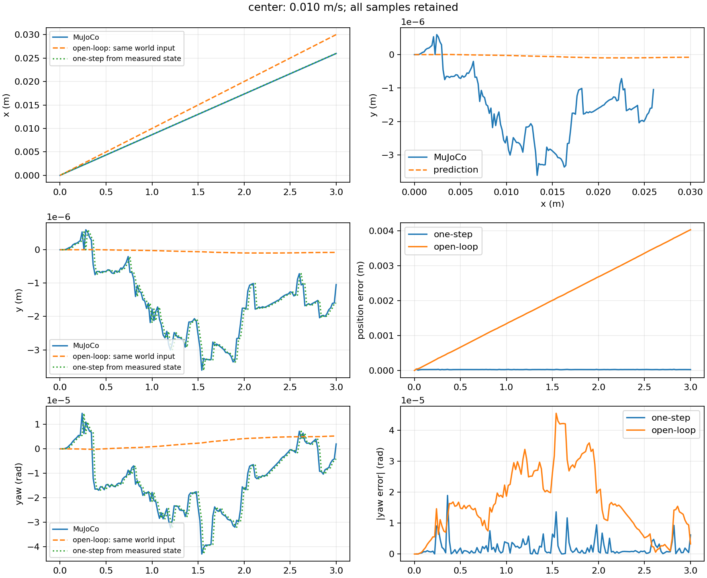
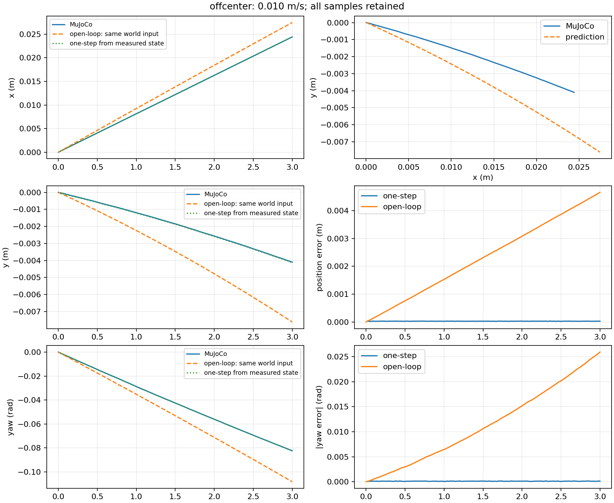
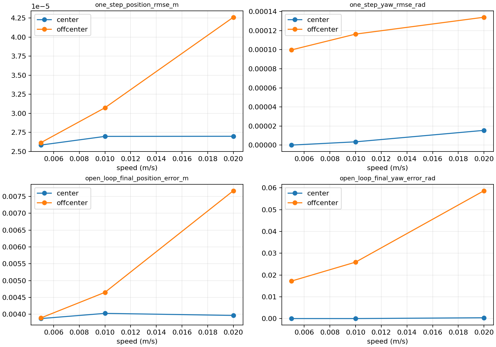
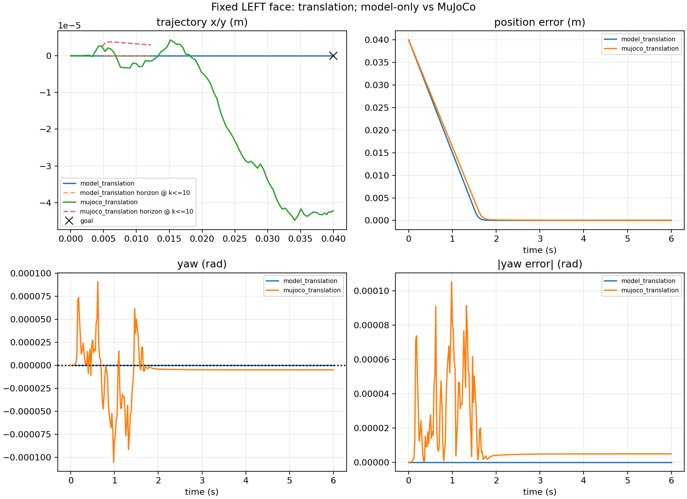
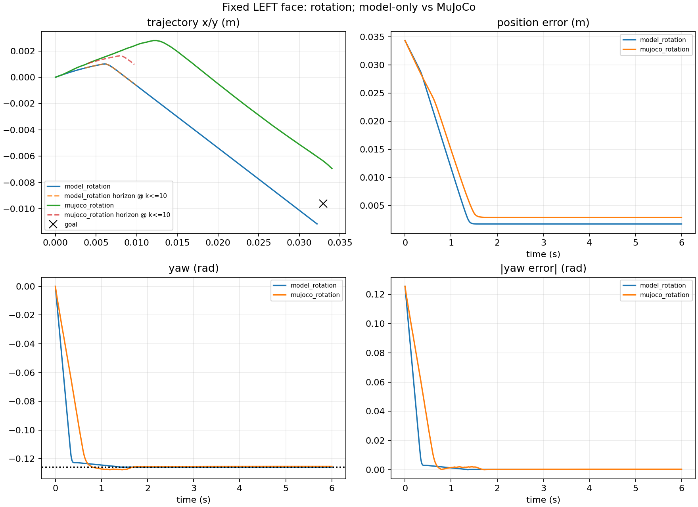
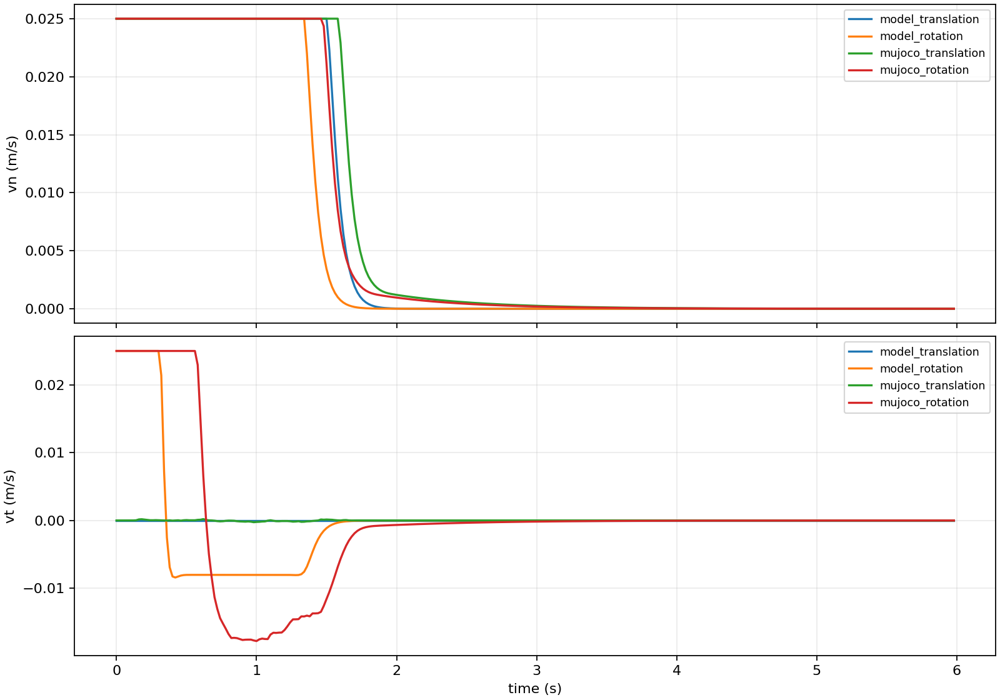
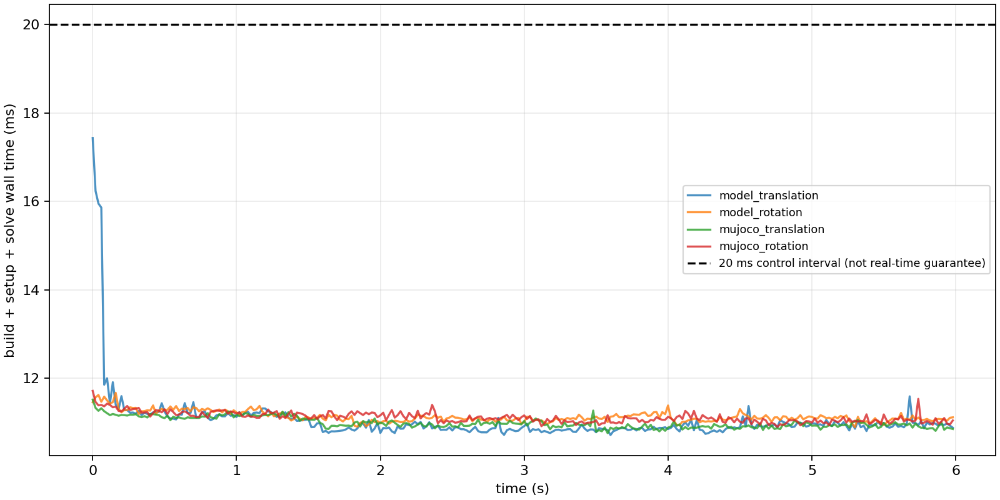

# Step 1 & Step 2 实施与验收报告

日期：2026-11-06，America/New_York。项目：Local vs. Sampling-Augmented MPC for Contact-Rich Planar Pushing under Model Uncertainty。

## 交付与范围

在原项目 `/home/jyguan/projects/meam5170-planar-pushing` 上增量实现，没有新建重复仓库。Step 0 的默认 mocap 路径、原 MJCF 与两个 Demo 保留；仅为真实切向速度增加可选 velocity_servo 模式。未实现接触面切换、重定位、sampling、robust control、sliding mode 或 contact-implicit 优化。没有创建 remote 或 Git 提交。

修改文件：`src/planar_pushing/env.py`（可选伺服兼容性扩展）、`pyproject.toml`（v0.2.0/依赖/CLI）、`requirements-lock.txt`、`.gitignore`、`README.md`。

新增文件：`MANIFEST.in`；`src/planar_pushing/models/{__init__,contact_geometry,quasi_static}.py`；`src/planar_pushing/control/{__init__,local_qp_mpc}.py`；`src/planar_pushing/{integration,experiment_io,validate_model,mpc_demo}.py`；`tests/{test_model,test_mpc,test_integration}.py`；三份 Step 1/2 技术文档，以及 results 中的配置/原始日志/图表/运行索引。

## 环境版本

Ubuntu 22.04.5 LTS，x86_64，Python 3.10.12，Git 2.34.1；复用原 `.venv`，没有 sudo/系统安装。仅新增 SciPy、OSQP 及其依赖 jinja2、MarkupSafe、joblib、cloudpickle。完整版本由 requirements-lock.txt 锁定；排除 ROS shell 注入的 PYTHONPATH。

| Package | Version |
|---|---|
| meam5170-planar-pushing | 0.2.0 |
| mujoco | 3.17.0 |
| numpy | 2.2.6 |
| scipy | 1.15.3 |
| osqp | 1.1.3 |
| matplotlib | 3.10.9 |
| pytest | 9.2.0 |
| pip | 26.3 |
| setuptools | 84.2.1 |
| wheel | 0.48.0 |

## 数学与实现选择

完整公式见 [model_design.md](model_design.md) 和 [mpc_design.md](mpc_design.md)。最终模型严格保持指定结构：x=(px,py,theta,s)，u=(vn,vt)，四个 face 的 n/t/r 符号显式定义，H=diag(1,1,ell^-2)，G=H Aᵀ solve(A H Aᵀ,F)，v_body=G u，世界平移由 R(theta) 变换，s_dot=0。Euler 离散；Jacobian 使用可配置中央差分，不 wrap theta、不越过物理接触面边界。Coulomb cone 施加于 scaled contact force D u，而不是未经推导的速度比。mu_ground_nominal 不人为缩放预测速度。

ell=0.04163332 m（矩形 RMS 半径启发式，未经标定），mu_pusher=0.5，mu_ground_nominal=0.3，fd_step=1e-6，corner_margin=2 mm。

MPC 为显式稀疏 multiple shooting：z=(x1...xH,u0...uH-1)，共 6H 变量/11H 约束行；使用带 c_k 的仿射动力学、输入 box、force cone 和固定 s 边界。P/q/A/l/u 由本项目构建，OSQP 仅数值求解。H=15，dt=0.02 s；沿用 Q=(20,20,5,0)、Qf=(80,80,20,0)、R=(0.1,0.1)、Rd=(0.2,0.2)，未通过改权重掩盖执行器问题。输入 vn∈[0,0.025]、vt∈[-0.025,0.025] m/s；正则化 epsilon=1e-9。OSQP eps_abs=eps_rel=1e-7，max_iter=4000，polishing；接受残差阈值5e-6。warm start 为移位输入和从最新测量状态重建的 rollout；不声称复用了 factorization。

## 实际测试

安装后的目标包、清除 PYTHONPATH/DISPLAY/WAYLAND_DISPLAY/MUJOCO_GL：**67 passed in 16.53s**。

| Test suite | Passed | 内容 |
|---|---:|---|
| 原 Step 0 | 25 | 初始化、物理推动、真实独立摩擦、复现、headless CLI |
| Step 1 | 21 | 四面几何/符号、接触速度恒等式、SPD、力锥、零/非零输入、独立方向导数、参数及地面摩擦抵消 |
| Step 2 | 12 | H=1/5/15/23、Hessian/完整目标、仿射残差、可手算最优解、warm-start、不可行、迭代失败、model-only tracking |
| Integration | 9 | 伺服真实速度、四面的实际 MuJoCo 接触点、model/MuJoCo 两种任务闭环回归 |

所有 imports 成功，安装后 `pip check` 无依赖冲突。四组闭环均正常完成 300 个控制步（6 s），无 fallback。测试包含真实 infeasible 与 max-iterations 结果，确认不会执行失败迭代。

## Step 1：实测预测误差

最终运行目录：`results/step1_20261106T143248-0500_b587de`。每组 3 s，初始 loaded contact 通过 settle+gentle physical approach 建立。不是通过修改 Slider 状态对齐。

One-step 从每一步实际测量状态预测；multi-step open-loop 只初始化一次，并重放相同世界 Pusher 速度参考指令（不是伺服实际测得的速度）。输入在各自角度下转换到模型 frame。所有样本保留，没有滤除不符合假设的轨迹。

| Case (m/s) | One-step position RMSE (mm) | One-step yaw RMSE (rad) | Open-loop final position (mm) | Open-loop final yaw (rad) | Unloaded endpoint samples | Slip flags | max s drift (mm) |
|---|---:|---:|---:|---:|---:|---:|---:|
| center_0.005 | 0.02582 | 3.37542e-09 | 3.8719 | 6.17419e-08 | 0 | 0 | 0.000 |
| center_0.010 | 0.02696 | 3.41248e-06 | 4.0265 | 3.26202e-06 | 0 | 0 | 0.001 |
| center_0.020 | 0.02698 | 1.54288e-05 | 3.9653 | 0.000379071 | 8 | 0 | 0.022 |
| offcenter_0.005 | 0.02613 | 9.97609e-05 | 3.8898 | 0.0172053 | 0 | 0 | 0.916 |
| offcenter_0.010 | 0.03073 | 0.000116353 | 4.6516 | 0.02591 | 0 | 0 | 2.268 |
| offcenter_0.020 | 0.04262 | 0.000134031 | 7.6687 | 0.0586733 | 11 | 1 | 5.331 |

中心推动主要平移，偏心推动的预测与实际 yaw 均为顺时针。新速度伺服存在负载下的速度跟踪误差：例如约0.6 N接触负载和500 N/(m/s)增益对应约1.2 mm/s的稳态速度差，3秒累积即为毫米级。因此最终中心开环误差约4 mm包含执行器误差，不能全归因于极限曲面模型；闭环反馈将其明显压低。误差随速度的趋势是观测结果；固定持续时间下，速度也改变总行程，不能把这个 sweep 解读为严格隔离惯性效应的实验。





## Step 2：model-only 与 MuJoCo 闭环

最终运行目录：`results/step2_20261106T143255-0500_c25ccc`。平移目标(0.04,0,0)；旋转任务 s=0.02 m，目标由一次可行模型 rollout 生成，约(0.032932,-0.009601,-0.125581)。生成的是固定目标，闭环中所有输入均来自每次 QP，不重放预设控制序列。

| Case | Position error initial → final (mm) | Absolute yaw error initial → final (rad) | Termination | Fallbacks | build+setup+solve mean / max (ms) |
|---|---:|---:|---|---:|---:|
| model_translation | 40.000 → 0.0000 | 0 → 4.96728e-36 | duration_complete | 0 | 11.050 / 17.438 |
| model_rotation | 34.303 → 1.7277 | 0.125581 → 0.000189402 | duration_complete | 0 | 11.136 / 11.675 |
| mujoco_translation | 39.997 → 0.0422 | 4.88237e-12 → 4.87701e-06 | duration_complete | 0 | 10.994 / 11.519 |
| mujoco_rotation | 34.300 → 2.8715 | 0.125569 → 0.000320373 | duration_complete | 0 | 11.119 / 11.717 |

| Case | Slip-flag samples | Unloaded endpoint samples | Max s drift (mm) | Max QP constraint violation | Invalid nominal force-cone commands |
|---|---:|---:|---:|---:|---:|
| model_translation | 0 | 0 | 0.000 | 2.78e-17 | 0 |
| model_rotation | 0 | 0 | 0.000 | 1.72e-10 | 0 |
| mujoco_translation | 0 | 5 | 0.027 | 2.78e-17 | 0 |
| mujoco_rotation | 61 | 17 | 4.296 | 1.41e-16 | 0 |

总 wall solve time 包含线性化、矩阵装配、OSQP setup/solve，而 solver_time 单列保存在 CSV 中。统计仅为本机一次运行，不是硬实时保证。完整循环还需要仿真、诊断和可选显示时间。直接 COO/CSC 装配替换了较慢的 sparse slice 累加；数学目标和约束未改变。






## 失败案例、诊断与必要调整

1. **原 mocap 偏心闭环失败**：初始 model-only 正常；MuJoCo 约0.84 s 后 s 达到面边界，位置误差仍约16.17 mm。实测 mocap 的 `mj_objectVelocity` 为零，即使位置更新速度是(0.025,0.025)。这使摩擦求解缺少所需的切向表面速度。依据 [MuJoCo 官方说明](https://mujoco.readthedocs.io/en/stable/modeling.html#mocap-bodies)，增加可选物理 XY slide joint+velocity actuator，默认 mocap 保持不变。失败日志：`results/step2_20261106T142226-0500_ca4168`。
2. **粗步长 servo 试验**：1 ms、gain=1000 时存在接触颤振，端点瞬间卸载使初版 loss guard 提前停止，平移/旋转都失败。没有删除日志；路径为 `results/step2_20261106T142405-0500_a5c4f1`。在 0.2 ms、gain=500 下稳定性改善，并将所有卸载端点继续记录，与“连续3个端点无载荷且间隙>0.5 mm”的宏观脱离停止条件区分。这是带有物理尺度的诊断规则，不代表微间隙期间理想 sticking 成立。
3. **有限半径与真实 slip**：最终旋转任务仍有 slip flags 和 s 漂移，QP nominal sticking 不等于真实 sticking。Pusher 不绕 z 自转，RFu 点速度近似与精确固定-s圆柱中心几何不能同时完全满足；接触 softness、ell 启发式与执行伺服误差也会影响结果。完整数据保留，不声称已消除 model mismatch。
4. **model-only 小残差**：旋转任务最终仍有约1.7 mm位置残差，角误差很小。局部短时域、只推不拉与欠驱动可使 QP 在小残差处停止；没有全局收敛保证，不能用延长实验或隐藏轨迹声称精确达到。
5. **物理接触与零输入**：力锥允许零输入，不能保证持续正压力。接触丢失、越面或 solver fallback 会显式记录并停止；没有自动换面或重定位。

结果索引 `results/run_index.json` 说明历史与最终运行用途。早期 JSON 不包含后续新增的 env_config 字段，以索引标注的物理配置为准；没有重新标记旧运行作为最终结果。

## 命令与可复现性

```bash
cd /home/jyguan/projects/meam5170-planar-pushing
source /home/jyguan/projects/meam5170-planar-pushing/.venv/bin/activate
unset PYTHONPATH
python -m pip install -r requirements-lock.txt
python -m pip install --no-build-isolation --no-deps -e .
python -m pip check
env -u DISPLAY -u WAYLAND_DISPLAY -u MUJOCO_GL python -m pytest -q
python -m planar_pushing.validate_model --output-dir results
python -m planar_pushing.mpc_demo --backend model --task both --headless --output-dir results
python -m planar_pushing.mpc_demo --backend mujoco --task translation --headless --output-dir results
python -m planar_pushing.mpc_demo --backend mujoco --task rotation --headless --output-dir results
# 合并四组对比图
planar-pushing-mpc --backend both --task both --headless --output-dir results
# 需要可访问的桌面；与本报告 headless 数值验收独立
planar-pushing-mpc --backend mujoco --task both --viewer --output-dir results
```

Step 1/2 主验收实际运行的是以上 validate_model 和合并四组 MPC 命令。新的 velocity_servo MPC Viewer 已实际运行两个任务各2秒（各100步），均完整完成并正常退出；日志在 `results/viewer_smoke/step2_20261106T143553-0500_94862f`。窗口同步通过程序运行验证，没有桌面截图人工审查；本报告6秒数值表仍来自独立 headless 验收。

每次新建带时间戳/唯一后缀目录，含全部配置、CSV、NPZ 和 PNG。requirements-lock.txt 锁定软件版本；跨平台/求解器版本与线程负载可能改变浮点轨迹和时间统计。模型无随机扰动，沿用 Step 0 reset(seed=0)；相同机器/配置可重现数值实验。

## 修改与下一步

替换物理模型改 `models/quasi_static.py`/`contact_geometry.py`，保持 model API 可复用 MPC；修改 H/dt/Q/R/约束改 `control/local_qp_mpc.py` 中 MPCConfig/显式 builder；替换 solver 只替换 setup/solve/status 层并保留 cost/residual tests；适配仿真 frame/有限半径改 `integration.py`。参数依赖表及详细替换约定见两份设计文档。

后续应先诊断/拟合 ell 与执行器误差、研究点接触与有限半径的一致性，再开展后续接触选择/重定位步骤。这里没有实现这些额外算法，也没有把已观测的真实 slip 宣称为已实现 sliding predictor。

Git 仍为 main，无提交、无 remote。全部新增源代码/文档尚未暂存，results 被忽略。原 Step 0 25 个测试未改动，原 MJCF、demo.py 字节保持不变；env.py 只作已说明的可选执行扩展。Step 1/2 验收无阻塞问题，但存在上述建模与局部跟踪限制。
