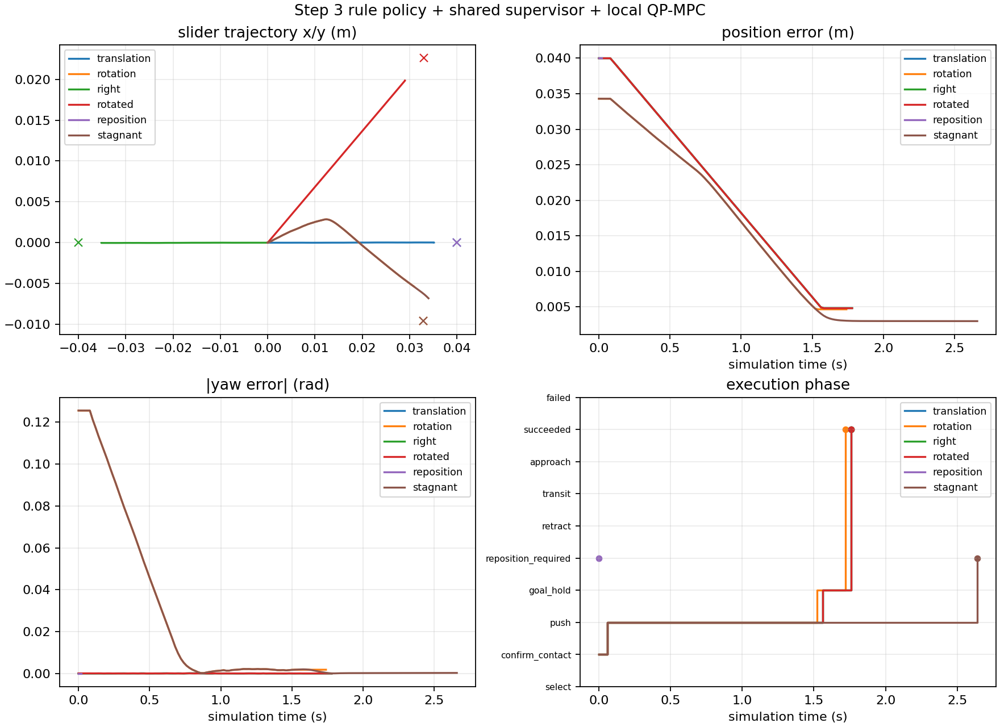

# Step 3 实施与验收报告

日期：2026-11-06，America/New_York。原项目：`/home/jyguan/projects/meam5170-planar-pushing`，版本 v0.3.0。

## 已完成的范围

实现 Controller A 的确定性规则选面/选点、停滞检测、实际接触监测、可替换组件接口和 shared task supervisor，并与现有 Local QP-MPC/MuJoCo 真实闭环集成。

Step 4 仅完成 RepositionPlanner / RepositionExecutor Protocol、请求/计划/状态值类型和 handoff 状态转移，**没有实现绕行算法或运行中的换面执行**。需要移动到新接触点时返回零速度和明确的请求，当前 demo 安全停止。没有将这种任务标为成功。

接口和修改边界见 [component_contracts.md](component_contracts.md)，算法、公式、参数表见 [step3_design.md](step3_design.md)。保持 world XY velocity 作为最终执行接口，ContactTarget=face+s，期望 s 与测得 s 分开。

## 文件变更

修改：`pyproject.toml`（0.3.0/CLI）、`README.md`（运行与修改说明）、`MANIFEST.in`（配置文件随 sdist 打包）。

新增：

- `src/planar_pushing/task/contracts.py`：contract version 1 的值类型和 Protocol。
- `task/geometry.py`：独立物理场景几何；复用原 contact 几何符号。
- `task/selection.py`：规则 A、滞回、失败点阻止与有限回退。
- `task/progress.py`：归一化、仿真时间窗口的停滞检测。
- `task/monitor.py`：实际接触面、载荷、gap、measured_s、slip 估计。
- `task/supervisor.py`：接触确认、推动、goal hold、异常/重新选点、Step 4 handoff。
- `task/adapters.py`：MuJoCo 观测适配、原 Local MPC 的世界速度适配。
- `task/__init__.py`，`src/planar_pushing/rule_demo.py`。
- `configs/step3_example.json`：可编辑的独立组件配置示例。
- `tests/test_rule_selection.py`、`tests/test_task_supervisor.py`、`tests/test_step3_integration.py`。
- 两份设计文档、本报告、`docs/step3_verification.json`、results 中的原始日志/图表。

原 Step 0–2 的源码与测试共 **19 个文件逐个 SHA-256 比对保持不变**；对应的67项原测试全部继续通过。未改变环境 reset/step/get_state、MuJoCo 场景、预测模型或 QP。

## 环境与测试

Ubuntu 22.04.5 LTS / Python 3.10.12，复用现有 `.venv`，没有新安装依赖、没有系统级安装。

| Package | Version |
|---|---|
| meam5170-planar-pushing | 0.3.0 |
| mujoco | 3.17.0 |
| numpy | 2.2.6 |
| scipy | 1.15.3 |
| osqp | 1.1.3 |
| matplotlib | 3.10.9 |
| pytest | 9.2.0 |

安装后 `pip check` 无冲突；清除 ROS PYTHONPATH 以及 DISPLAY/WAYLAND_DISPLAY/MUJOCO_GL 后运行：

```text
103 passed in 25.93s
```

其中原测试67项，Step 3新增36项。新增测试覆盖四面和旋转坐标选点、偏心力矩方向、角度周期性、hysteresis、有限规则回退、时间窗口/噪声、接触确认、goal hold、Step 4 缺省与模拟 port handoff、微间隙与宏观丢失、错误面/越界/漂移、solver失败、最短保持/重试/超时、同面重新选点清除 warm start、真/预测参数独立、固定任务目标不随 nominal ell 改变、真实六组演示，以及无显示的重复 CLI 输出不覆盖。

## 最终真实 MuJoCo 演示

最终 headless 运行：`results/step3_20261106T151337-0500_47f454`。所有任务目标与完整展开配置均保存，包含场景/模型/MPC/规则/监测/任务阈值/停滞配置。

| Task | Result | Final position error (mm) | Final yaw error (deg) | Steps | Selections | Solver failures |
|---|---|---:|---:|---:|---:|---:|
| translation | succeeded | 4.8289 | 0.000525 | 89 | 1 | 0 |
| rotation | succeeded | 4.6551 | 0.102888 | 87 | 1 | 0 |
| right | succeeded | 4.8289 | 0.000525 | 89 | 1 | 0 |
| rotated | succeeded | 4.8092 | 0.001101 | 89 | 1 | 0 |
| reposition | reposition_required_step4_unavailable | 40.0000 | 0.000000 | 1 | 1 | 0 |
| stagnant | reposition_required_step4_unavailable | 2.9944 | 0.014736 | 133 | 2 | 0 |

translation/right 为 +/-40 mm 平移；rotation 为既定平移加旋转目标；rotated 在初始 yaw=0.6 rad 的物体坐标系中推动。四个成功任务按 **5 mm / 3 deg，连续保持0.2 s** 验收，因达到任务容差而提前停止；不能将最终约4.7–4.8 mm误差与 Step 2 连续推动6秒后的稳态误差混比。这是显式成功定义，不是改 MPC 权重或降低已有物理测试。

reposition 将 Pusher 真实初始化在错误的一侧，控制器仅发出 left-face 重定位请求，solve_count=0，输出零速度，物块/Pusher未瞬移。stagnant 使用同一物理旋转任务，但成功阈值收紧为0.5 mm / 0.005 rad；局部残差约3 mm，实际触发1秒窗口的停滞并重新选点，随后等待 Step 4。没有冻结或写入 Slider 状态来制造停滞。



| Task | Mean build+solve time (ms) | Slip flags | Unloaded contact samples | Max desired/measured s difference (mm) |
|---|---:|---:|---:|---:|
| translation | 11.338 | 0 | 10 | 0.014 |
| rotation | 11.409 | 51 | 18 | 3.498 |
| right | 11.332 | 0 | 10 | 0.014 |
| rotated | 11.336 | 0 | 5 | 0.009 |
| stagnant | 11.291 | 57 | 21 | 4.412 |

solver 时间为 adapter 收集的原 MPC 总求解时间（包括线性化/构建/setup/solve），不包含整个 task loop、物理积分和绘图，不作为硬实时保证。每步 CSV 保存 phase/reason、desired/measured s、gap、载荷、slip、世界指令、solver状态/残差/迭代/目标、progress metric；NPZ保存物块/Pusher状态、时间、世界速度和误差。所有事件与选择原因保存在 summary。

## 关键边界与设计决定

1. 规则只选择目标；solver、运动执行和环境不在 selector 中。
2. Supervisor 不持有 env，不调用 env.reset/mj_step，不写 qpos/qvel。初始化仅在 demo runner 中进行；以后 Step 4 不能复用带 reset 的旧初始化 helper。
3. 初始接触需真实低速接近建立载荷，再连续确认60 ms才激活MPC。未来 motion port 的 READY 同样不能绕过物理确认。
4. MPC 使用 measured_s，不把 desired_s 写回状态；同面换点也清除 warm start。
5. 真实 friction 与模型 friction、物理 geometry 与名义模型独立注入。修改 nominal 参数不会改变真值或 benchmark goal。
6. 安全异常与停滞分开处理；绕行/等待/接触确认不计入停滞窗口。到达位置和角度阈值后还需保持。
7. signed gap 相对于所选面，不是任意位置的全局净间隙；错误侧不会因负 gap 被误认为已接触并启动推动。
8. Step 4 尚缺少真实路径/执行器时，没有错误地把本次 A 说成已具备运行中换面能力。

## Viewer、配置和运行命令

实际启动 `--task rotation --viewer` 并完整达到目标，进程正常结束；记录为 `results/step3_viewer/step3_20261106T151246-0500_217aa0`，共87个执行/同步步。属于窗口创建/同步与物理执行验证，没有桌面截图人工审查。最终数值表来自独立 headless 运行。

JSON 示例加自定义世界目标(0.05,0,0)也实际成功运行，日志在 `results/config_smoke/`。未识别 section/field 会报错；在 env partial override 时沿用本版本 velocity_servo profile。`geometry` 物理尺寸必须与场景一致，corner_margin可改；nominal 模型尺寸可独立修改并自行记录 mismatch。

```bash
cd /home/jyguan/projects/meam5170-planar-pushing
source /home/jyguan/projects/meam5170-planar-pushing/.venv/bin/activate
unset PYTHONPATH
python -m pip install --no-build-isolation --no-deps -e .
python -m pip check
env -u DISPLAY -u WAYLAND_DISPLAY -u MUJOCO_GL python -m pytest -q
planar-pushing-rule --task all --headless
planar-pushing-rule --task rotation --viewer
planar-pushing-rule --task translation --config configs/step3_example.json --goal 0.05 0 0 --headless
# 等价的模块入口
python -m planar_pushing.rule_demo --task stagnant --headless
```

## 已知限制与下一步

当前目标是 Step 3，在初始接触已就位的简单任务中完成规则选点+MPC闭环，同时验证重新选点事件。Step 4缺失时，错误初始接触、停滞后换点等任务有意停止等待；需要下一步实现真正退离/绕行/接近，才能完成需换面的任务。全部Step 4协议和状态机入口已预留。

A的规则与归一化尺度/阈值是工程选择，无全局可达性或收敛保证。真实 slip 和 soft-contact 卸载仍存在并记录，没有实现 sliding predictor。最短保持、blocked目标和任务选择次数上限防止抖动/无限重试，但无法替代更好的高层策略。以后 B/C替换 selector，继续共用supervisor、local MPC和Step 4执行；替换模型或不同维度控制器需更新对应 adapter/内部QP，不必重写选点与绕行。

Git仍为main，无提交、无remote；新增/修改文件尚未暂存。results继续被忽略。原文件没有删除，未创建GitHub仓库。Step 3范围内无未解决的阻塞问题；尚未完成Step 4是本轮明确的范围边界。
