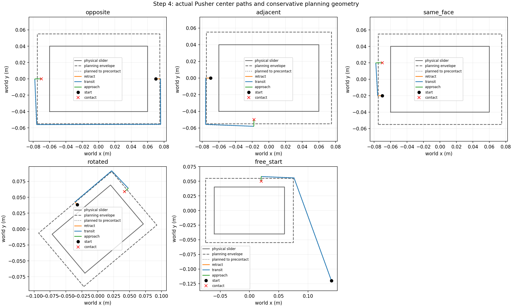
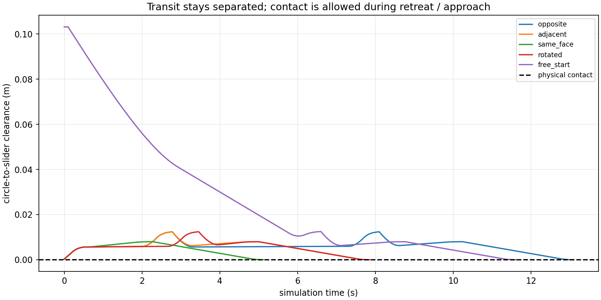
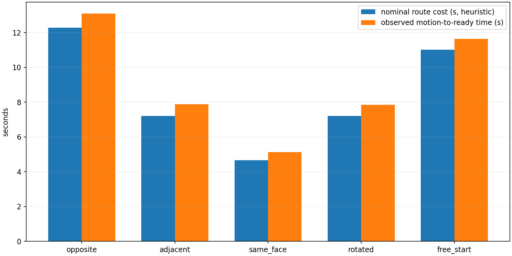
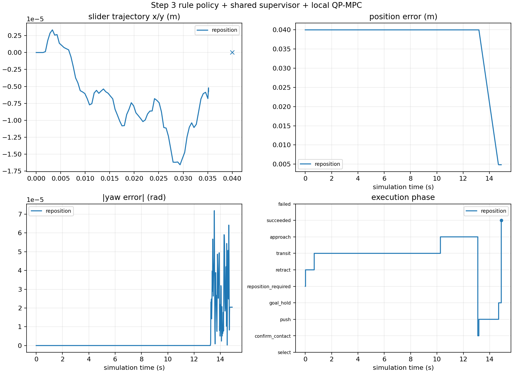
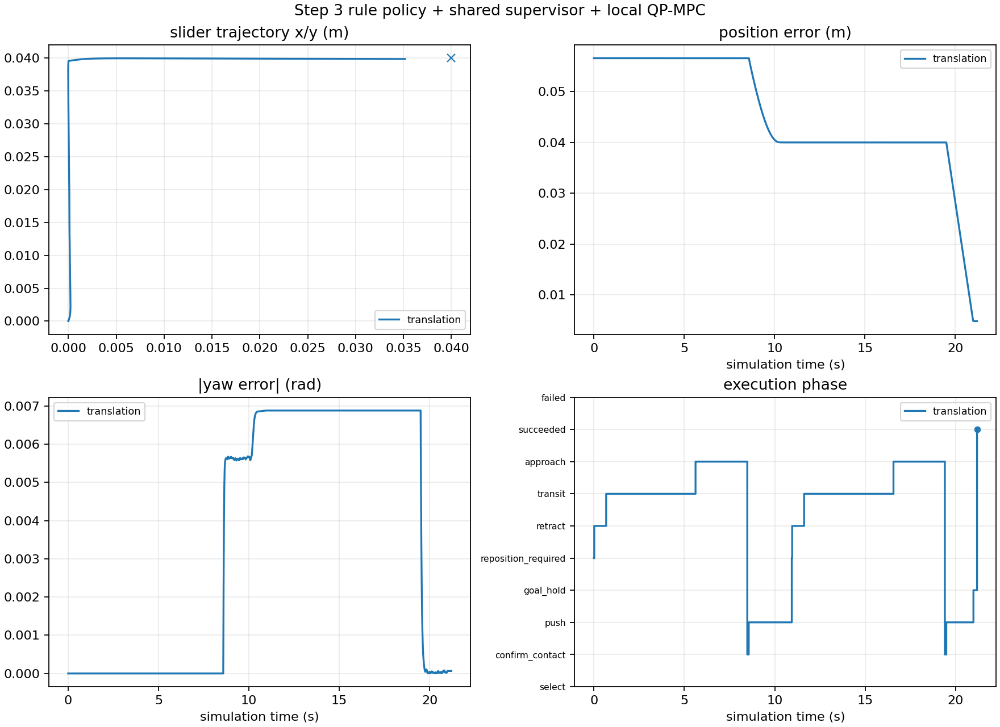

# Step 4 实施与验证报告

日期：2026-11-06（America/New_York）。原项目 `/home/jyguan/projects/meam5170-planar-pushing`，版本v0.4.0。

## 已完成内容

完成真实 Pusher 的 **退离 → 无接触绕行 → 接近**，通过 Step 3 已定义的 RepositionPlanner / RepositionExecutor port 接入现有 TaskSupervisor，再由同一个 Local QP-MPC 推动物块。没有运行中 reset，没有写入 Slider 状态，没有瞬移 Pusher。

路径、代价、碰撞检查和运动控制分别独立：VisibilityRepositionPlanner、NominalTimeCost、CollisionChecker、FeedbackRepositionExecutor。可替换其中任意算法而保留其余组件；预测模型与QP变量不进入这些模块。见 [算法与代价设计](step4_design.md) 和 [当前接口边界](component_contracts.md)。

## 文件与兼容性

新增 `src/planar_pushing/motion/{collision,cost,planner,executor,__init__}.py`、`motion_demo.py`、三份motion测试、`configs/step4_example.json`、设计/实测/verification文档及结果图表日志。

增量修改 `task/contracts.py`（默认可选字段与MotionCost/CostEvaluator）、`task/__init__.py`（导出）、`task/supervisor.py`（自定义运动端异常转成明确失败）、`rule_demo.py`（可选真实port/配置/全阶段物理日志）、`pyproject.toml`（0.4.0/新CLI）、README与接口文档。

原Step 0–2的**19个源码/测试文件**仍逐个SHA-256匹配；Step 3原有默认未注入port的行为保持，新功能需显式 `--with-reposition`。现有103个测试没有删除或修改且继续全部通过。Contract version=1，additive revision=1，旧构造参数和Protocol调用保持有效。`step4_enabled`表示当前运行是否启用端口；历史字段`step4_implemented`保留为相同意义的别名。

## 环境与依赖

Ubuntu22.04.5 LTS / Python3.10.12 / 原项目venv，**没有新增依赖或系统安装**。pip check通过。

| Package | Version |
|---|---|
| meam5170-planar-pushing | 0.4.0 |
| mujoco | 3.17.0 |
| numpy | 2.2.6 |
| scipy | 1.15.3 |
| osqp | 1.1.3 |
| matplotlib | 3.10.9 |
| pytest | 9.2.0 |

## 路线和cost设计

物块在body frame按Pusher半径加5mm安全余量保守膨胀为矩形，routing vertices额外外移1mm。触碰起点先沿外侧轴退出包络；深度互穿>1mm拒绝。可见图只有起点、预接触终点与4个角点，枚举最多65条简单路径。每条完整线段用analytic slab intersection过滤，cost只在已可行的路线之间选优。

Jtravel保留原约定：**退离+绕行到预接触的路径长度（m）**。独立的默认选路total为

`L_retreat/0.015 + L_transit/0.03 + gap_precontact/0.003 + 0.05*sum(turn_angle_rad) + 0.1`，单位秒。

预接触gap=8mm；转弯包含末段到接近方向。它是名义完成时间加工程转弯惩罚，不是精确物理时间模型，不包含Jpush/Jswitch。可更换CostEvaluator返回其他带明确单位的cost；规划/碰撞/执行接口不变。原长度项仍可供未来B/C使用，不能偷偷把米改成秒。

执行器用实际中心位置反馈，执行guard=1.5mm、waypoint容差0.4mm；先卸载并等物块稳定，再TRANSIT。每步检查当前物块位姿下的预测扫掠段，意外载荷则停止。物块漂移>1mm/0.02rad触发从新观测重规划，最多3次。接近低速建立载荷，READY后supervisor继续独立确认接触，之后才激活MPC。

## 测试结果

清除ROS PYTHONPATH和DISPLAY/WAYLAND_DISPLAY/MUJOCO_GL，用安装后的包运行：

```text
151 passed in 76.88s
```

151=原103+新增48：planner22、execution23、闭环/CLI3。覆盖线段穿越与边界、64个随机/特定合法起点、所有目标面、旋转等变、独立稠密物理距离核查、cost分项/单位/替换、错误第三方计划、真实初始碰撞、意外载荷、执行guard、位姿重规划上限、观测时钟/速度/稳定超时，以及**真实MuJoCo全部16个有向面组合**和自由起点。

motion矩阵验收条件包括：到达正确的loaded目标接触、无TRANSIT载荷、采样间隙>4mm、TRANSIT物块位移<0.2mm、整个运动物块位移<0.5mm、Pusher单步位移<0.8mm，且三阶段均实际出现。没有靠放宽旧物理测试通过。

## 独立三动作实测

最终记录：`results/step4_20261106T154557-0500_58eb1f`。五组包括对侧、相邻、同面换点、yaw=0.7rad物块、自由中心起点；均完成loaded目标接触。

| Case | Jtravel (m) | nominal route cost (s) | observed ready time (s) | min sampled transit clearance (mm) | loaded transit samples | total slider translation (um) |
|---|---:|---:|---:|---:|---:|---:|
| opposite | 0.270052 | 12.283 | 13.100 | 5.647 | 0 | 1.509 |
| adjacent | 0.120050 | 7.204 | 7.880 | 5.647 | 0 | 4.061 |
| same_face | 0.046065 | 4.660 | 5.140 | 5.647 | 0 | 3.824 |
| rotated | 0.120076 | 7.205 | 7.860 | 5.646 | 0 | 2.765 |
| free_start | 0.243311 | 11.017 | 11.640 | 6.309 | 0 | 3.922 |

名义与实际时间不同，实际还包括反馈减速、waypoint切换和载荷确认。Jtravel不含接近，而实际中心总距离含接近，不能把两个不同端点的距离当同一个误差指标。TRANSIT不接触；退离/接近允许真实接触和微小物块运动，已单列记录。





## 与规则A和MPC完整闭环

| Task | Result | final position error (mm) | final yaw error (deg) | selections | physical motion plans | min sampled transit clearance (mm) | max transit normal force (N) |
|---|---|---:|---:|---:|---:|---:|---:|
| wrong_side | succeeded | 4.8262 | 0.001171 | 1 | 1 | 5.648 | 0.0 |
| switch | succeeded | 4.8270 | 0.003736 | 2 | 2 | 5.648 | 0.0 |

wrong_side：从物块右侧起步，实际绕行到左侧，再由MPC完成+X目标。JSON示例配置在该实验中实际使用。

switch：固定世界目标(0.04,0.04,0)，单个连续episode中先推动一个方向，再由停滞/规则选择切换接触面并继续推动。summary包含选择面和每次接触确认事件；CSV/NPZ时间严格连续，Pusher没有跨物块跳转。两次运动计划中可能包含首次选点后从初始化接触到所需接触的转移；不把“计划次数”冒充全部都是运行中换面次数。

成功定义仍为Step 3的5mm/3deg并保持0.2s，没有为Step 4另放宽。原模型误差和实际slip仍可能存在，Step 4不会把它们伪装成理想sticking；本次任务成功不构成任意目标的全局保证。

wrong_side日志：`results/step4_tasks/wrong_side/step3_20261106T154823-0500_a75223`；switch日志：`results/step4_tasks/switch/step3_20261106T154828-0500_74bad8`。




原始CSV在所有阶段额外保存physical_clearance_m和physical_normal_force_N，不依赖PUSH阶段才有的contact estimate。NPZ保存实际物块/Pusher位姿和世界速度；summary保存所有配置、计划、分项cost、重规划/READY事件、solver结果。观测指标是控制步采样值；路线与预测控制段另作连续线段几何检查，不声称对任意未观测动态有形式安全保证。

## Viewer验证

实际运行 `--task reposition --with-reposition --duration 30 --viewer`，完成三段运动、supervisor接触确认、MPC推动和goal hold，最终succeeded；共745个执行/同步步。记录为 `results/step4_viewer/step3_20261106T154937-0500_20c76f`。这是窗口创建/同步和物理执行验证，没有桌面截图人工审查；数值表来自独立headless运行。

## 运行命令

```bash
cd /home/jyguan/projects/meam5170-planar-pushing
source /home/jyguan/projects/meam5170-planar-pushing/.venv/bin/activate
unset PYTHONPATH
python -m pip install --no-build-isolation --no-deps -e .
python -m pip check
env -u DISPLAY -u WAYLAND_DISPLAY -u MUJOCO_GL python -m pytest -q
planar-pushing-motion --case all --headless
planar-pushing-rule --task reposition --with-reposition --duration 30 --config configs/step4_example.json --headless
planar-pushing-rule --task translation --goal 0.04 0.04 0 --with-reposition --duration 30 --headless
planar-pushing-rule --task reposition --with-reposition --duration 30 --viewer
```

每次运行新建独立目录，避免覆盖。完整设计、参数表和替换示例见step4_design.md；没有新增ROS、规划大型依赖、sampling或robust controller。

## 限制和后续修改

- 默认可见图基于保守矩形，不是圆角障碍的精确连续最短路径；边角可能多绕一些。
- 只使用平面真值观测，假定物块可以稳定下来；不处理外部障碍、未知快速运动或明显倾覆。深互穿、预算耗尽、非法接触会明确失败。
- time cost含启发式转弯项，不经过标定；不是硬实时/动作时间保证。
- 默认规则A仍是启发式，无全局到达保证。真实滑移和小残差由原推模型/执行器决定，Step 4不引入新的sliding predictor。
- 更换预测模型/MPC只需对应push adapter/内部求解；更换路线、cost、碰撞或跟踪器分别替换其port。非矩形或多物体会要求几何/接触描述适配或版本升级，不能承诺任何语义变化零成本。

当前Step 4范围内无未解决的阻塞问题。Git仍为main，无提交、无remote，源代码/文档尚未暂存，results被忽略；原Step 0–3成果未删除。
